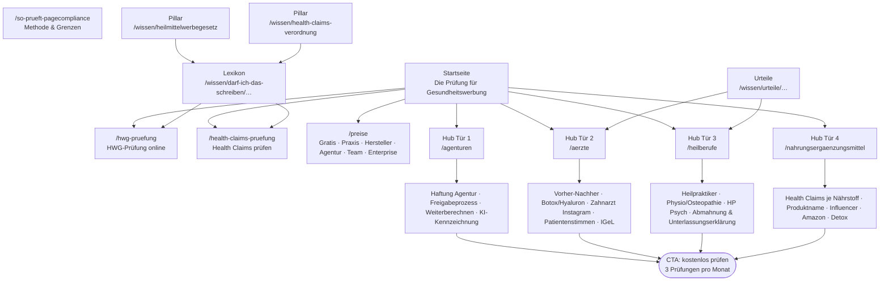
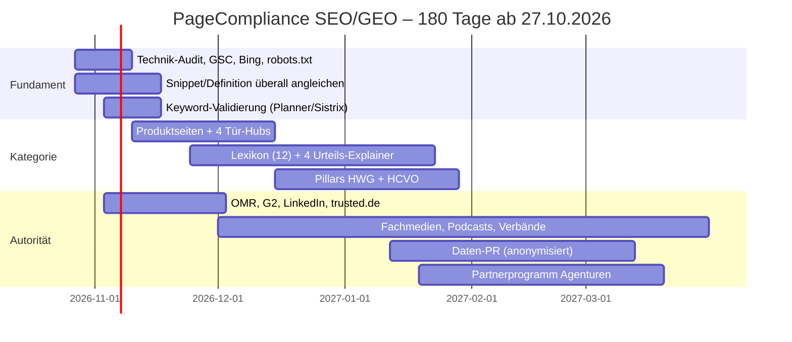

# PageCompliance besetzt eine leere Kategorie, bevor andere es tun

**Recherche-Stand: 23.10.2026 · Für: Massimiliano Ehmann (CCO) · Sprachbasis: Leitfaden „PageCompliance – Sprache & Außendarstellung“ v1.0 vom 22.10.2026**

## 1. Kurzfazit: Die Kategorie ist frei, aber PageCompliance ist heute praktisch unsichtbar

PageCompliance hat ein seltenes Fenster. In den recherchierten Suchergebnissen gibt es **keinen Anbieter, der Selbstbedienung, HWG + Health-Claims-Verordnung + UWG in einer Prüfung, den besseren Satz je Fundstelle und die Kundenfreigabe per Link verbindet**. Der Markt zerfällt in Agentur-Services (smugo „HWG-Wächter“), Pharma-Enterprise-Lösungen (Dr. Kaske, Caidera), Claim-Datenbanken (Bohillebrand, Behr's) und Nischen-Tools wie ein kostenloses WordPress-Plugin „HWG Check“ ([smugo](https://smugo.de/hwg-waechter/), [wordpress.org](https://wordpress.org/plugins/?p=348161), [Bohillebrand](https://www.bohillebrand.de/en/lebensmittelrecht/health-claims-checker/)). Gleichzeitig ist PageCompliance in den Suchergebnissen fast nicht vorhanden: **Indexiert ist nur eine einzige Seite (/ueber-uns)**. Bei der reinen Markensuche erscheint die Firma gar nicht, und bei Suchen nach dem Problem („HWG prüfen“, „Health Claims Check“) gewinnen andere ([Über uns](https://pagecompliance.de/ueber-uns), [Munich Startup](https://www.munich-startup.de/startups/pagecompliance/)). Das indexierte Snippet spricht außerdem noch von „Healthcare Website Compliance Checker für eine automatische **Vorprüfung**“. Das ist halb englisch, ohne UWG und widerspricht dem Leitfaden vom 22.10. Daraus folgt meine Empfehlung in drei Schritten. Erstens das Fundament in 30 Tagen: Technik-Audit, Indexierung in Google, Bing und Brave, eine konsistente Entität mit der Definition im Wortlaut. Zweitens in 90 Tagen eigene Produktseiten für die Kaufbegriffe („HWG-Prüfung“, „Health Claims prüfen“) und ein Lexikon „Darf ich das so schreiben?“ je Tür. Es beantwortet genau die Fragen, die Texterinnen, Praxen und Hersteller in Google und ChatGPT eintippen. Drittens bis Tag 180 Off-Page-Autorität über OMR Reviews, Fachmedien, LinkedIn, YouTube und ein Partnerprogramm für Agenturen. **GEO ist kein eigenes Spiel neben SEO.** Google sagt selbst, Optimierung für KI-Suche sei „still SEO“ ([Search Engine Journal](https://www.searchenginejournal.com/googles-new-ai-search-guide-calls-aeo-and-geo-still-seo/575026/)). Der eigentliche GEO-Hebel sind **Erwähnungen von PageCompliance auf fremden Seiten**, vor allem auf Vergleichs- und Bewertungsseiten. Das größte Eigenrisiko ist die eigene Werbesprache: Wer Compliance verkauft, darf selbst nicht irreführend werben.

### Die fünf Kernentscheidungen auf einen Blick

| # | Entscheidung | Warum | Wann |
|---|---|---|---|
| 1 | Technik und Indexierung zuerst, Content danach | Es ist nur eine Seite indexiert. Ohne Index gibt es weder Rankings noch KI-Zitate. | Tag 0–14 |
| 2 | Kaufbegriffe mit eigenen Produktseiten besetzen | Wettbewerber tragen das Keyword im Produktnamen („HWG-Wächter“, „HWG Check“). | Tag 14–45 |
| 3 | Lexikon „Darf ich … schreiben?“ und Urteils-Explainer je Tür | Hier ist die SERP schwach und alt, und das Format zeigt das Produkt (Befund → Norm → besserer Satz). | ab Tag 30, laufend |
| 4 | Off-Page: OMR Reviews, G2, Fachmedien, LinkedIn, YouTube | KI-Systeme nennen Tools vor allem über Vergleichs- und Bewertungsseiten, nicht über die Hersteller-Website. | ab Tag 14, laufend |
| 5 | Messung über ein Prompt-Panel plus Search Console und Bing | Klicks aus KI-Antworten sind gering. Sichtbarkeit und Nennungen sind die eigentliche Währung. | ab Tag 7 |

### Was diese Recherche kann und was nicht

Die Grenzen gehören an den Anfang, damit keine Schätzung als Messung durchrutscht. **Direkte Seitenabrufe waren blockiert.** `curl` auf pagecompliance.de lieferte HTTP 403 vom Proxy, und WebFetch scheiterte an DNS. Title-Tags, Meta-Descriptions, H1/H2, JSON-LD, robots.txt, sitemap.xml, llms.txt und das Rendering (SSR oder reines JavaScript) der eigenen Website konnten deshalb **nicht geprüft werden**. Das gilt auch für alle Wettbewerberseiten: Deren Angaben stammen aus Such-Snippets. **Das Suchwerkzeug ist ein US-Index und nicht Google.de.** Die Reihenfolge der Treffer ist ein Hinweis darauf, welche Domains für eine Anfrage als relevant gelten, aber kein Beleg für Google-Positionen. Featured Snippets, „Ähnliche Fragen“ und AI Overviews waren nicht sichtbar. **Kein einziges Suchvolumen ist gemessen.** Autocomplete, Google Trends, Keyword Planner und Sistrix waren nicht erreichbar. Alle Volumenangaben in diesem Report sind grobe Schätzungen in drei Stufen und als solche markiert: niedrig ≈ unter 100, mittel ≈ 100–1.000, hoch ≈ über 1.000 Suchen pro Monat. **ChatGPT, Perplexity und Gemini wurden nicht live abgefragt.** Viele GEO-Studien stammen von Tool-Anbietern mit Eigeninteresse und sind oft nur aus Zweitquellen bekannt. Daraus folgt: Die Prio-A-Keywords müssen vor der Redaktionsplanung im Google Keyword Planner (Standort DE) und in Sistrix validiert werden, und das Technik-Audit muss jemand mit Zugriff auf die Seite nachholen.

---

## 2. Ist-Analyse: Eine indexierte Seite, ein veraltetes Snippet, keine Drittquellen außer Munich Startup

### Was Suchmaschinen und KI heute über PageCompliance finden

Die Bestandsaufnahme ist kurz, weil es wenig zu finden gibt. Eine `site:pagecompliance.de`-Abfrage lieferte **genau eine Seite: /ueber-uns**. Startseite, Preise, FAQ oder Blog waren im genutzten Index nicht auffindbar ([Über uns](https://pagecompliance.de/ueber-uns)). Bei der Suche „PageCompliance HWG Prüfung“ steht **der Munich-Startup-Eintrag auf Platz 1, vor der eigenen Domain** ([Munich Startup](https://www.munich-startup.de/startups/pagecompliance/)). Das spricht für eine junge Domain mit wenig Autorität und dünner Indexierung. Die reine Markensuche „PageCompliance“ in Anführungszeichen liefert keinen Treffer zur Firma, sondern generische „page + compliance“-Ergebnisse wie Pagefreezer, eine Egnyte-Fallstudie zur Architekturfirma „Page“ und Astra-Hilfeseiten ([Egnyte/Page](https://www.egnyte.com/events/summit/2024/globalsummit/on-demand/how-page-uses-egnyte-to-protect-data-and-deliver-projects-on-time), [PageFreezer](https://en.wikipedia.org/wiki/PageFreezer)). Eine echte Namenskollision mit einem Konkurrenten gibt es nicht. Das Problem ist ein anderes: **„PageCompliance“ besteht aus zwei generischen englischen Wörtern** und wird erst durch Kontext (HWG, Gesundheitswerbung, München) als eigene Marke erkennbar. Off-Page wurden keine LinkedIn-Firmenseite, keine auffindbaren Gründerprofile, kein Northdata- oder Handelsregistertreffer, keine Bewertungsprofile (OMR, Capterra, G2) und keine Presseartikel gefunden. Das beruht auf fehlenden Suchtreffern und ist keine direkte Prüfung. Gerade LinkedIn sollte direkt kontrolliert werden, weil LinkedIn-Seiten oft verzögert indexiert werden.

| Signal | Befund (Stand 23.10.2026) | Bewertung |
|---|---|---|
| Indexierte Seiten | 1 (/ueber-uns) | kritisch; Ursache offen (junge Domain, JS-Rendering, fehlende Sitemap oder noindex) |
| Markensuche „PageCompliance“ | kein Treffer zur Firma | kritisch für GEO: Die Marke ist keine erkennbare Entität |
| Markensuche mit Kontext | Munich Startup vor eigener Domain | schwache Domain-Autorität |
| Non-Brand („HWG Tool“, „Health Claims Check“) | nicht vorhanden; smugo, Plugin, Pharma Text Checker, Händlerbund u. a. erscheinen | Lücke |
| Drittquellen | nur Munich Startup | KI hat zu wenig Material für eine Antwort |
| LinkedIn, Register, Bewertungsportale | nicht gefunden | prüfen und anlegen |
| Technik (Meta, Schema, robots.txt, Sitemap, SSR) | **nicht prüfbar** (Proxy-Block) | manuell nachholen, Priorität 1 |

### Der Widerspruch im Snippet: „Vorprüfung“, halb Englisch, ohne UWG

Die Suchmaschine zitiert von der Website die Positionierung **„Healthcare Website Compliance Checker für eine automatische Vorprüfung auf HWG- und EU-Compliance“** sowie den Satz „Das KI-gestützte SaaS-Tool filtert vor, der Mensch entscheidet“ ([Über uns](https://pagecompliance.de/ueber-uns)). Daran stimmen vier Dinge nicht. Erstens ist seit dem 22.10.2026 **„Prüfung“ der Markenbegriff, „Vorprüfung“ wird nicht mehr verwendet**. Das Snippet hinkt dem Leitfaden also hinterher, und Suchmaschinen und LLMs geben die alte Formel weiter, bis neu gecrawlt wurde. Zweitens ist „Healthcare Website Compliance Checker“ eine englisch-deutsche Mischformel. Sie enthält keinen der Begriffe, nach denen eine deutsche Agentur suchen würde, etwa „HWG-Prüfung“, „Heilmittelwerbegesetz“ oder „Health Claims prüfen“. Drittens fehlt das **UWG**, obwohl die Definition ausdrücklich drei Regelwerke nennt. Viertens weicht „filtert vor, der Mensch entscheidet“ vom verbindlichen Leitsatz ab: „Die Software liest mit. Entscheiden tut der Mensch.“ Dieser Punkt ist für GEO besonders wichtig. Der Leitfaden verlangt die Definition „überall identisch“, weil KI-Suchsysteme eine Firma über konsistente Beschreibungen einordnen. Derzeit kursieren mindestens drei Beschreibungen: das Snippet, der Munich-Startup-Text („KI-gestützte SaaS-Lösung zur Prüfung von Werbeinhalten im Gesundheitsmarkt“) und die Definition aus dem Leitfaden ([Munich Startup](https://www.munich-startup.de/startups/pagecompliance/)).

**Korrektur (Wortlaut nach Leitfaden, auf Website, LinkedIn, Munich Startup und in allen Verzeichnissen identisch):**

> PageCompliance ist die Plattform für Gesundheitswerbung. Agenturen, Praxen, Heilberufe und Hersteller prüfen ihre Texte KI-gestützt auf Risiken nach Heilmittelwerbegesetz (HWG), Health-Claims-Verordnung und UWG – bekommen für jede kritische Stelle den besseren Satz und geben gemeinsam frei.

### Die Zahl „über 2.500 EU Health Claims“ ist unpräzise

Die Website prüft laut Snippet „gegen über 2.500 EU Health Claims und das Heilmittelwerbegesetz“ ([Über uns](https://pagecompliance.de/ueber-uns)). Zum Vergleich: Bohillebrand nennt **240 zugelassene Claims für 82 Nährstoffe** nach VO 432/2012 ([Bohillebrand](https://www.bohillebrand.de/en/lebensmittelrecht/health-claims-checker/)). Die Verbraucherzentrale spricht von 222 zugelassenen Angaben im Jahr 2012, „inzwischen rund 250“ ([Verbraucherzentrale](https://www.verbraucherzentrale.de/wissen/lebensmittel/kennzeichnung-und-inhaltsstoffe/lebensmittel-mit-gesundheitsversprechen-11035)). Ein Bericht über OTC-AI nennt rund 260 ([Business Punk](https://www.business-punk.com/otc-marketing-ki-agenten-otc-ai/)). Die 2.500 beziehen sich vermutlich auf alle Einträge im EU-Register, also auch auf abgelehnte und anhängige (on hold). Ohne diese Erklärung liest eine Fachperson oder ein LLM die Zahl als Übertreibung. Das schadet der Glaubwürdigkeit eines Compliance-Anbieters und ist nach § 5 UWG ein eigenes Risiko. Außerdem steht die Zahl nicht auf der „Belegt“-Liste des Leitfadens. **Empfehlung:** Die Zahl entfernen, bis Leon die genaue Zusammensetzung aus dem Register belegt. Danach höchstens: „geprüft gegen das EU-Register gesundheitsbezogener Angaben – zugelassene, abgelehnte und noch offene Angaben“, mit Datum und ohne nicht nachgezählte Zahl.

---

## 3. Wettbewerb und SERP-Lücken: Die Kaufanfragen sind leer, die Ratgeber sind alt

### Kein direkter Wettbewerber, aber vier Gruppen, die das Feld teilweise besetzen

| Gruppe | Beispiele | Was sie tun | Was ihnen fehlt (Chance für PageCompliance) |
|---|---|---|---|
| Agentur-Services | smugo „HWG-Wächter“, Webdesign-Agenturen für Ärzte (adfera, digitalmann) | prüfen und schreiben neu, „Erst-Check kostenlos“, Service statt Selbstbedienung ([smugo](https://smugo.de/hwg-waechter/), [adfera](https://adfera.de/branchen/webdesign-fuer-aerzte/)) | Selbstbedienung, Tempo, Freigabe-Workflow, wiederholbare Prüfung |
| Pharma/Enterprise | Dr. Kaske KAI/MediCheck, Caidera, Smile AI | MLR-Prozesse, Pflichtangaben, Claim-Bibliotheken ([drkaske](https://drkaske.de/medicheck-compliance/), [Caidera](https://www.caidera.ai/de/blog/heilmittelwerbegesetz-compliance)) | andere Zielgruppe; besetzen aber dieselben Suchbegriffe |
| Claim-Datenbanken und Checks zum Festpreis | Bohillebrand (kostenlos), Behr's (Abo), Händlerbund (49,90 € netto für 5 Seiten) | Lookup ohne Textanalyse bzw. einmalige Prüfung ([Händlerbund](https://www.haendlerbund.de/de/ratgeber/recht/3881-heilmittelwerbegesetz), [Behr's](https://www.behrs.de/health-und-nutrition-claims/c-1598)) | Textanalyse je Kanal, Dosisbezug im Fließtext, Wiederholung |
| Nischen-Tools | WordPress-Plugin „HWG Check“, OTC-AI, Shopify-App Aplomb (US/FDA) | nur HWG und nur WordPress bzw. nur OTC bzw. nur US-Recht ([wordpress.org](https://wordpress.org/plugins/?p=348161), [pickyourapp](https://pickyourapp.com/de/products/aplomb)) | HCVO + UWG, Agentur-Mehrkunden, Kundenfreigabe |

Zwei Befunde zählen für die Strategie. Erstens setzt der Markt **Preisanker nahe null**: Bohillebrand und das Plugin sind kostenlos, Händlerbund kostet 49,90 €, smugo bietet einen kostenlosen Erst-Check an. PageCompliance kann diesen Wettbewerb nicht über den Preis je Prüfung gewinnen und soll es laut Leitfaden auch nicht („nie günstig“). Gewonnen wird **über den Weg bis zur Freigabe**: Prüfen → Besser so → Abstimmen → Freigegeben → Planen → Wächter. Diesen Weg bietet niemand sonst. Zweitens tragen alle Wettbewerber das Keyword im Produktnamen („HWG-Wächter“, „HWG Check“, „Pharma Text Checker HWG“). PageCompliance trägt es nirgends. Das ist der wichtigste Grund, warum eigene, klar benannte Produktseiten die erste Content-Aufgabe sind.

### Wo die SERP schwach ist

| Anfrage (US-Index, nicht Google.de) | Wer heute auftaucht | Lücke |
|---|---|---|
| „HWG Prüfung“ | **kein einziger thematisch passender Treffer** (Hepatitis-G-Patente, HRG-Prüfungsdidaktik) ([HRK](https://hrk.de/hrk-at-a-glance/library/online-catalogue/export/wie-soll-man-studenten-pruefen-das-neue-hrg-ermoeglicht-eine-neue-pruefungsdidaktik)) | transaktionale Seite fehlt; die Abkürzung ist mehrdeutig, daher immer mit „Heilmittelwerbegesetz“ kombinieren |
| „Werbetext prüfen lassen Arzt“ | keine Anlaufstelle für eine Prüfung, nur Ghostwriting und Pflichttexte ([pressetext](https://www.pressetext.com/news/professionelles-ghostwriting-und-content-fuer-arztpraxen-und-zahnmedizin-in-d-a-ch.html)) | Produktseite für Ärzte |
| „HWG Heilpraktiker Werbung“ | Kammer-PDFs, **BGH-Urteile von 1983** ([anwalt24](https://www.anwalt24.de/urteile/bgh/1983-11-17/i-zr-5_81)), medizinio | aktueller, strukturierter Heilberufe-Hub |
| „Health Claims Verordnung Liste“ | IT-Recht Kanzlei, WKO-Infoblatt von 2013, BfR-Verweis auf das EU-Register ([WKO 2013](https://wko.at/ktn/handel/lebensmittelhandel/informationen-gesundheitsbezogene-angaben-stand-oktober-2013.pdf), [BfR](https://www.bfr.bund.de/de/health_claims-9196.html)) | durchsuchbare Liste als HTML-Seite mit Verwendungsbedingungen |
| „Nahrungsergänzungsmittel Werbung erlaubt“ / „Influencer“ | Verbraucherzentrale, foodwatch, Presse (Sicht der Verbraucher) ([VZ](https://www.verbraucherzentrale.de/wissen/lebensmittel/nahrungsergaenzungsmittel/werbung-fuer-nahrungsergaenzungsmittel-durch-influencerinnen-123719)) | Herstellersicht mit konkreten Umformulierungen und Creator-Briefing |
| „Vorher Nachher Bilder Werbung Arzt“ | Ärzteblatt, beck-aktuell, Rose & Partner, jura.cc zu BGH I ZR 170/24 und OLG Frankfurt 6 U 40/25 ([beck-aktuell](https://www.beck-aktuell.de/heute-im-recht/rechtsprechung/bgh-izr17024-influencer-aesthetify-vergleichsbilder-werbung-hyaluron-dr-rick-dr-nick-2025-07-31)) | „Was heißt das für Ihre Texte?“ mit 10 umformulierten Captions; Kanzleien referieren, die Presse meldet, aber keiner liefert Sätze |
| „Heilmittelwerbegesetz verbotene Wörter“ | keine offizielle Liste; Agentur-Listen (huchel), Kammer-Broschüren ([huchel](https://huchel-medienagentur.de/wissen/hwg-verstoesse-arzt-website)) | ehrliche Antwortseite: „Es gibt keine Liste. Diese Muster werden häufig beanstandet – mit Norm und besserem Satz.“ |

Zwei Content-Konkurrenten tauchen immer wieder auf. **medizinio.de** erscheint als einziger Ratgeber, der keine Kanzlei ist, in mehreren Arzt- und Heilpraktiker-Anfragen und ist damit der wichtigste Wettbewerber im Content. **Händlerbund** zeigt das Muster, das PageCompliance übernehmen sollte: Ratgeber mit eingebettetem Check ([Händlerbund HCVO](https://www.haendlerbund.de/de/ratgeber/branchen/3949-health-claims-verordnung)). Ein Urteil erzeugt innerhalb weniger Tage eine eigene Cluster-SERP aus Fachpresse und Kanzleien. Wer zu jedem Leiturteil schnell eine Seite mit Beispielsätzen vorher und nachher liefert, besetzt ein Format, das weder Kanzleien noch Presse anbieten. Ein Beleg für die Produktlogik kommt aus der Rechtsprechung selbst. Das OLG Düsseldorf hielt eine Aussage zur Schmerzfreiheit in einer Heilpraktiker-Anzeige **ausnahmsweise für zulässig, weil sie klar als individueller Erfahrungsbericht erkennbar war** (20.02.2025, I-20 U 53/24) ([WBS](https://www.wbs.legal/wettbewerbsrecht/heilpraktiker-werbung-olg-duesseldorf-erlaubt-ausnahmsweise-aussage-zur-schmerzfreiheit-82534/)). Die Formulierung entscheidet. Genau das ist „der bessere Satz“.

### Österreich und Schweiz: vorerst nicht

Gemeinsam ist der DACH-Region im Kern nur die HCVO. Österreich regelt Ärztewerbung über das Ärztegesetz und das Standesrecht. Heilpraktiker gibt es dort nicht so wie in Deutschland. Die Schweiz hat mit HMG, AWV und Swissmedic ein eigenes Recht ([Swissmedic](https://www.swissmedic.ch/swissmedic/de/home/news/mitteilungen/gesetzlicher-auftrag-kontrolle-werbung-am.html), [jusline VwGH 2007](https://www.jusline.at/entscheidung/27640)). Da PageCompliance nach deutschem Recht prüft, empfehle ich **nur Deutschland**. Österreich kann später über NEM-Inhalte mitgenommen werden, mit Hinweis und ohne hreflang, bis es eine eigene Prüflogik gibt.

---

## 4. GEO-Mechanik: Was belegt ist und was Hype ist

### Retrieval: Jede KI-Suche ruht auf einem klassischen Index

Alle großen Systeme arbeiten mit Retrieval auf einem Suchindex, aber nicht alle auf demselben. **Google AI Overviews und AI Mode** nutzen den Google-Index mit „query fan-out“. Laut Google braucht eine Seite dafür nichts weiter, als indexiert und mit Snippet anzeigbar zu sein, es gibt „keine zusätzlichen Anforderungen“ ([Google Search Central](https://developers.google.com/search/docs/appearance/ai-features)). **ChatGPT** stützt sich auf Bing und auf OpenAIs eigenen OAI-SearchBot ([OpenAI Crawler](https://developers.openai.com/api/docs/bots)). **Copilot** nutzt Bing. **Perplexity** hat einen eigenen Index. **Claude** nutzt sehr wahrscheinlich Brave Search, das ist aber nicht offiziell bestätigt ([Anthropic Help Center](https://support.claude.com/en/articles/8896518-does-anthropic-crawl-data-from-the-web-and-how-can-site-owners-block-the-crawler), [shahabpapoon](https://www.shahabpapoon.com/blog/claude-web-search-runs-on-brave)). AI Overviews gibt es in Deutschland seit März 2025, AI Mode auf Deutsch seit 7. Oktober 2025 ([onlinemarketing.de](https://onlinemarketing.de/technologie/google-search-ai-mode-startet-in-deutschland)). Für PageCompliance heißt das: **Wer nur in Google arbeitet, fehlt in ChatGPT und Claude.** Bing Webmaster Tools und eine Kontrolle in Brave gehören deshalb von Tag 1 an dazu.

```
                     ┌──────────────── Ihre Seite ────────────────┐
                     │  indexiert? crawlbar? Text im HTML?         │
                     └───────┬──────────────┬──────────────┬───────┘
                             │              │              │
                       Google-Index     Bing-Index     Brave-Index    (+ eigene Indizes:
                             │              │              │           OAI-SearchBot,
             AI Overviews / AI Mode   Copilot, ChatGPT   Claude        PerplexityBot)
                             │              │              │
                             └──── Antwort zitiert Quellen, in denen die ────┘
                                  Marke + Kategorie gemeinsam vorkommen
```

### Belegt, umstritten, Hype

| Hebel | Status | Evidenz | Konsequenz für PageCompliance |
|---|---|---|---|
| Normale SEO-Qualität (Index, Crawlbarkeit, Text, interne Links) | **belegt (offiziell)** | Google: GEO „is still SEO“ ([SEJ](https://www.searchenginejournal.com/googles-new-ai-search-guide-calls-aeo-and-geo-still-seo/575026/)) | Basis zuerst |
| Retrieval-Crawler zulassen (OAI-SearchBot, PerplexityBot, Claude-SearchBot, Claude-User) | **belegt (offiziell)** | Wer blockt, verliert Sichtbarkeit in der jeweiligen KI-Suche ([Anthropic](https://support.claude.com/en/articles/8896518-does-anthropic-crawl-data-from-the-web-and-how-can-site-owners-block-the-crawler)) | robots.txt und WAF prüfen |
| Zitate, Statistiken und Quellenangaben im Text | **belegt (Labor)** | GEO-Paper (KDD 2024): Gegenüber einer Basis von rund 19,4 erreichte „Quotation Addition“ 27,2 (≈ +40 %), „Statistics“ 25,2 (≈ +30 %), „Cite Sources“ 24,6 (≈ +27 %). Gemessen an Engines von 2023 ([arXiv](https://arxiv.org/abs/2311.09735)). | Normen, Aktenzeichen und Zitate in jede Seite einbauen. Das ist für Rechtsinhalte ohnehin Pflicht. |
| Keyword-Stuffing | **belegt schädlich (Labor)** | rund −8 bis −10 % ([blckalpaca](https://blckalpaca.at/en/knowledge-base/seo-geo/geo-generative-engine-optimization/the-princeton-geo-study-methodology-results-and-critique)) | nicht tun |
| Markenerwähnungen auf fremden Seiten | **starke Korrelation (Anbieterstudie)** | Ahrefs, 75.000 Marken: YouTube-Erwähnungen ≈ 0,737, unverlinkte Erwähnungen ≈ 0,664, Backlinks ≈ 0,218 ([blckalpaca](https://blckalpaca.at/en/knowledge-base/seo-geo/geo-generative-engine-optimization/brand-mentions-vs-backlinks-the-ahrefs-75k-brand-study)) | Off-Page = PR und Erwähnungen, nicht nur Linkaufbau |
| Bewertungs- und Vergleichsseiten für „Welches Tool …?“ | **starke Korrelation (DACH)** | OMR/Radyant (Juni 2026): **OMR Reviews ist mit 13,5 % die meistzitierte Quelle** bei Software-Empfehlungen; **rund 81 % der Review-Zitate kommen von Vergleichsseiten** ([OMR Reviews](https://omr.com/de/reviews/b2b/growthhub/quellen-llms-software-empfehlungen)). Eigenstudie von OMR. | OMR-Profil plus Bewertungen, in Kategorie-Vergleichen auftauchen |
| Firmenseiten als Quelle in DACH | **Studie (Anbieter)** | blinq: 66,2 % der zitierten Quellen sind Firmenseiten, **Fachartikel gehören zu den seltensten** ([t3n](https://t3n.de/news/chatgpt-perplexity-co-diese-quellen-nutzen-ki-tools-am-haeufigsten-und-das-ist-ein-problem-1754013/)) | Eigene Seiten können zitiert werden, brauchen aber Verbreitung |
| Überschneidung mit Google-Rankings | **umstritten** | Semrush: ≈ 97 % der AIO-Zitate aus den Top 20. Ahrefs 2026: nur ≈ 38 % aus den Top 10. ChatGPT-Longtail: ≈ 8–12 % aus den Top 10 ([Semrush](https://semrush.com/blog/ai-mode-comparison-study), [vibhe](https://vibhe.com/blog/ranking-in-google-wont-get-you-cited-in-chatgpt)) | Google-Ranking hilft bei AIO, für ChatGPT reicht es nicht |
| Listicles („beste Tools …“) | **umstritten** | 43,8 % der ChatGPT-Zitate bei Software-Prompts (Ahrefs). Laut Peec später −50,5 % Zitatanteil nach einem Modellwechsel 2026 ([marketmaze](https://www.marketmaze.me/p/chatgpt-listicle-citation-share)) | in fremden Listen auftauchen; keine eigene Listicle-Farm |
| Aktualität | **Studie** | KI-zitierte Seiten sind im Schnitt 25,7 % „frischer“, aber immer noch fast 3 Jahre alt ([Ahrefs](https://ahrefs.com/blog/do-ai-assistants-prefer-to-cite-fresh-content)) | „Stand“-Datum und Änderungsprotokoll pflegen |
| llms.txt | **Hype** | Google: nicht nötig. **97 % der llms.txt-Dateien bekamen im Mai 2026 null Abrufe** ([PPC Land](https://ppc.land/llms-txt-adoption-rises-8-8x-but-97-of-files-get-zero-ai-requests/)) | 30 Minuten Aufwand, niedrige Priorität, nie als Rankingfaktor verkaufen |
| Spezielles Schema für KI | **Hype** | Google: kein spezielles Markup nötig. Ahrefs (1.885 Seiten): kein positiver Effekt auf AIO-Zitate ([seo-kreativ](https://www.seo-kreativ.de/en/blog/structured-data-and-ai-overviews/)) | Schema nur für Entitätsklarheit, nicht für Zitate |
| FAQ-Rich-Results | **weg** | seit 2023 eingeschränkt, laut einer Zweitquelle im Mai 2026 entfernt ([elementera](https://www.elementera.com/blog/google-has-removed-faq-rich-results)) | FAQ als sichtbaren Text behalten, ohne Snippet-Erwartung |
| Seitenfarmen je Fan-out-Variante (Stadt × Beruf × Wort) | **Risiko** | Scaled-Content-Abuse-Policy, 2026 laut Berichten aktiv durchgesetzt ([PPC Land](https://ppc.land/scaled-content-abuse/)) | wenige tiefe Hubs statt tausender dünner Seiten |

Zwei Zahlen relativieren den Nutzen von GEO. Auf Anfragen mit AI Overview fiel die organische CTR laut Seer von 1,76 % auf 0,61 %. Zitierte Marken bekamen aber mehr Klicks als nicht zitierte, laut einem Update von 2026 rund 120 % mehr pro Impression ([Seer Interactive](https://www.seerinteractive.com/news/fast-company-featured-ai-search-study-from-seer-interactive)). Daraus folgt: **Gemessen werden Nennungen und Sichtbarkeit, nicht nur Traffic.** Hinzu kommt ein Punkt aus dem YMYL-Bereich. KI-Antworten zu Gesundheitsthemen sind nachweislich fehleranfällig ([SEJ/Guardian](https://www.searchenginejournal.com/the-guardian-google-ai-overviews-gave-misleading-health-advice/564476/)). Systeme greifen deshalb bevorzugt auf Quellen mit klarer Autorschaft, präzisen Normzitaten und gepflegtem Stand zurück. Für PageCompliance ist das ein Vorteil: Ein Anbieter, der jede Aussage mit Norm und Aktenzeichen belegt, liefert genau das Material, das sich zitieren lässt.

---

## 5. Die Strategie: Die Kategorie „Prüfung für Gesundheitswerbung“ besetzen und über vier Türen ernten

### 5.1 Positionierung: Ein Satz, überall gleich, und ein Keyword im Seitennamen

Die Positionierung steht im Leitfaden bereits fest und muss nicht neu erfunden werden: **„PageCompliance – die Prüfung für Gesundheitswerbung.“** Für SEO fehlt ihr nur die Brücke zu den Suchbegriffen. Diese Brücke bauen die Seitennamen und Title-Tags, nicht der Claim. Die Marke bleibt „Prüfung für Gesundheitswerbung“, die Seiten heißen so, wie gesucht wird: „HWG-Prüfung“, „Health Claims prüfen“, „Werbung für Arztpraxen prüfen“. Die Abgrenzung zum Wettbewerb läuft über den Workflow, nicht über die Textprüfung allein. Anders als ChatGPT stellt PageCompliance alle Fragen und zeigt die Norm. Anders als der Anwalt arbeitet es in Sekunden statt Tagen (gemessen 11–53 s je Text). Anders als ein Service bleibt die Hoheit beim Kunden. Und anders als die meisten Tools führt es bis zur Freigabe. Eine Ableitung aus der Keyword-Recherche (nicht gemessen) verändert die Gewichtung: **Der Hauptkäufer (Agentur-GF) sucht kaum, aber die Texterin sucht ständig.** Sie googelt „Darf ich schmerzfrei schreiben?“ oder „Vorher-Nachher-Bilder Zahnarzt erlaubt?“, also exakt die Fragen von Tür 2 bis 4. Content für Praxen, Heilberufe und Hersteller ist deshalb **zugleich Akquise für Tür 1**. Er muss nur auf jeder Seite einen Agentur-Hinweis tragen.

### 5.2 Content-Architektur: Hub & Spoke je Tür



Die Architektur folgt drei Regeln. **Erstens:** Ärzte und Heilpraktiker bekommen getrennte Hubs, getrennte Lexikon-Einträge und eine eigene Tonalität, weil der Leitfaden verlangt, sie „nie in einen Topf“ zu werfen. Approbierte Psychotherapeuten liegen unter Heilberufe, aber auf eigener Unterseite (die Tonalität ist offen). **Zweitens:** Jede Wissensseite endet mit einer Produktdemo und nicht mit einem Download. Der Leitfaden schließt Downloads auf der Website aus („nur Anmeldung“). Das betrifft auch das gesuchte Format „Health Claims Liste PDF“: Es wird als durchsuchbare HTML-Seite beantwortet, nicht als PDF. **Drittens:** Es gibt keine Seitenfarm. Spezialseiten entstehen nur, wo echter Spezialinhalt existiert, also eigene Normen, Urteile und Beispielsätze. Seiten wie „HWG-Check für Zahnärzte in Köln“ wären Scaled Content Abuse.

| Format | Aufbau | Ziel-Keywords (Beispiele) | Umfang Welle 1 |
|---|---|---|---|
| Produktseite | Problem → Demo (Befund, Norm, besserer Satz) → Weg bis zur Freigabe → kostenlos prüfen | hwg prüfung online, health claims prüfen, werbetext prüfen lassen | 2 Seiten plus 4 Tür-Hubs |
| Lexikon „Darf ich … schreiben?“ | kurze Antwort (2 Sätze) → warum riskant (Norm, Urteil) → wann es geht → 3 bessere Sätze → „Ihren Satz kostenlos prüfen“ | schmerzfrei, heilt, stärkt das Immunsystem, detox, ohne Nebenwirkungen | 12 Einträge, danach 4 pro Monat |
| Urteils-Explainer | Leitsatz → Aktenzeichen, Datum, Gericht → was es für Texte heißt → 10 Beispiel-Captions vorher/nachher | BGH I ZR 170/24, OLG Frankfurt 6 U 40/25, OLG Düsseldorf I-20 U 53/24, KG Berlin 5 U 9/24 | 4 Seiten, danach je neuem Leiturteil |
| Pillar | strukturierte Übersicht mit Paragrafen-Ankern, „Stand“, Änderungsprotokoll | heilmittelwerbegesetz, § 3/§ 11/§ 12 hwg, health claims verordnung | 2 Pillars |
| Methode | „So prüft PageCompliance“: Regelwerke, Grenzen, Mensch entscheidet | pagecompliance erfahrungen, wie funktioniert hwg prüfung | 1 Seite |

### 5.3 Beispiel-Copy nach Leitfaden (Title, Meta, H1)

Alle Vorschläge sind gegen die Checkliste in Abschnitt 9 des Leitfadens geprüft: Sie-Anrede, „Prüfung“ statt „Vorprüfung“, KI nicht in Title oder H1, kein „rechtssicher“ und kein „garantiert“, Zahlen nur aus der Belegt-Liste, Ende in Ruhe.

| Seite | Title-Tag (≈ 60 Zeichen) | Meta-Description | H1 |
|---|---|---|---|
| Startseite | PageCompliance – die Prüfung für Gesundheitswerbung | Prüfen Sie Ihre Texte auf Risiken nach HWG, Health-Claims-Verordnung und UWG. Für jede kritische Stelle der bessere Satz. 3 Prüfungen im Monat kostenlos. | Erst prüfen, dann veröffentlichen. |
| /hwg-pruefung | HWG-Prüfung online: Texte nach Heilmittelwerbegesetz prüfen | Text einfügen, jede kritische Stelle mit Grund und Norm sehen, den besseren Satz übernehmen. Gemessen 11–53 Sekunden je Text. Jetzt kostenlos prüfen. | HWG-Prüfung: Jede kritische Stelle mit Norm und besserem Satz |
| /health-claims-pruefung | Health Claims prüfen – Texte für Nahrungsergänzungsmittel | Was Sie bei welcher Dosis wo sagen dürfen: Shop, Amazon, Instagram. Jede Aussage mit Grund und Norm, dazu der bessere Satz. Kostenlos prüfen. | Etikett rein. Text raus. Ruhe. |
| /agenturen | Prüfung und Kundenfreigabe für Healthcare-Agenturen | Ein Prüfschritt, den Ihr Kunde sieht und den Sie weiterberechnen. Bei 12 € Weiterberechnung je Text trägt sich das Agentur-Paket ab dem 9. Text. Ihr Kunde gibt per Link frei. | Ihr Kunde fragt nicht mehr, ob er das so schreiben darf. |
| /aerzte | Werbung für Arztpraxen prüfen: Website, Instagram, Anzeigen | Vorher-Nachher, Patientenstimmen, IGeL: Sehen Sie, welche Stellen zählen und wie der Satz besser klingt. Wissen, wo Sie stehen. Ohne Termin. | Ihr ganzer Auftritt auf einer Fläche. Und was davon zu tun ist. |
| /heilberufe/heilpraktiker | Heilpraktiker-Werbung prüfen: Texte nach HWG und UWG | „Schmerzfrei“, „heilt“, „stärkt das Immunsystem“: Sehen Sie, welcher Satz bleiben darf und wie der andere klingen kann. Ruhig veröffentlichen. | Ihre Botschaft bleibt erhalten. |
| Lexikon „schmerzfrei“ | Darf ich „schmerzfrei“ schreiben? HWG-Beispiele | Warum „schmerzfrei“ in Gesundheitswerbung riskant ist, wann es ausnahmsweise geht (OLG Düsseldorf 2025) und drei bessere Sätze. Stand: [Datum]. | Darf ich „schmerzfrei“ schreiben? |
| Urteil BGH | BGH I ZR 170/24: Vorher-Nachher-Verbot – was jetzt gilt | Das BGH-Urteil vom 31.07.2025 zu Unterspritzungen, erklärt für Ihre Texte und Posts. Mit zehn Captions vorher und nachher. | Vorher-Nachher nach BGH I ZR 170/24: Was Sie jetzt noch zeigen können |
| Ratgeber Thema Abmahnschutz | Abmahnschutz im Gesundheitsmarketing: 5 Sätze zum Streichen | Fünf Formulierungen, die häufig beanstandet werden, mit Norm und besserem Satz. Mehr Abmahnschutz, bevor der Text online geht. | Abmahnschutz im Gesundheitsmarketing: 5 Sätze, die Sie streichen sollten |
| Anwalt-Kosten | Was kostet eine HWG-Prüfung beim Anwalt? Und die Stufe davor | Die anwaltliche Einzelprüfung kostet ab 399 €. Behalten Sie Ihren Anwalt: Er bekommt markierte Stellen statt eines ungelesenen Textes. | Zum Anwalt geht nur, was rot bleibt. |

Zwei Hinweise zur Copy. Die Formel „Sekunden statt Tage“ ist ein Vergleich mit dem Anwalt. Das OLG Köln hat Smartlaw die Werbung „günstiger und schneller als ein Anwalt“ rechtskräftig untersagt ([LTO](https://www.lto.de/recht/juristen/b/bgh-urteil-izr11320-vertragsgenerator-smartlaw-keine-unzulaessige-rechtsdienstleistung-rak-hamburg-rdg-legal-tech)). Die eigene Seite ist mit 11–53 s gemessen. Für die „Tage“ auf Anwaltsseite und die 399 € braucht es eine **dokumentierte Quelle mit Datum und Screenshot**. Die Recherche konnte die 399 € extern nicht bestätigen. Außerdem liegt der Fokus der Agentur-Copy bewusst auf „Prüfschritt im Workflow“ und nicht auf „Rechtsprüfung als Service“ (siehe Abschnitt 8, § 5 RDG).

### 5.4 Technik: Erst sichtbar machen, dann optimieren

| Maßnahme | Detail | Priorität |
|---|---|---|
| Rohabruf und Rendering prüfen | `curl -A Googlebot https://pagecompliance.de/`. Steht im HTML nur eine JS-Hülle ohne Text, SSR oder Prerendering einführen. Die meisten KI-Crawler führen kein JavaScript aus (Einschätzung, nicht in dieser Recherche gemessen). | P1, Tag 1–3 |
| Search Console und Bing Webmaster Tools | Sitemap einreichen, Indexierung der Kernseiten anstoßen, /ueber-uns neu crawlen lassen (wegen des veralteten Snippets). In Bing den Bericht „AI Performance“ aktivieren: Er zeigt kostenlos die Zitate in Copilot ([Bing Blog](https://blogs.bing.com/webmaster/February-2026/Introducing-AI-Performance-in-Bing-Webmaster-Tools-Public-Preview)). IndexNow aktivieren. | P1, Tag 1–7 |
| robots.txt und WAF | Zulassen: Googlebot, Bingbot, OAI-SearchBot, ChatGPT-User, PerplexityBot, Perplexity-User, Claude-SearchBot, Claude-User. Trainings-Crawler (GPTBot, ClaudeBot, Google-Extended, CCBot) sind eine Geschäftsentscheidung; für eine neue Marke empfehle ich, sie zuzulassen. Cloudflare blockt KI-Agenten laut einem Bericht von 2026 in neuen Zonen standardmäßig ([anakin.io](https://anakin.io/blog/cloudflare-ai-agent-blocking-default-2026)). | P1 |
| Brave-Kontrolle | Brand- und Kategorie-Suche auf search.brave.com; die Quelle für Claude | P2 |
| Structured Data | `Organization` (Name, Logo, Gründer, Sitz, `sameAs` auf LinkedIn, Munich Startup, OMR, später Wikidata); `SoftwareApplication` mit `Offer` je Paket (Bewertungen nur echte); `Article` und `Person` für Autorinnen und Autoren; `BreadcrumbList`. Nutzen: Entitätsklarheit, nicht mehr Zitate. | P2 |
| URL- und Linkstruktur | sprechende deutsche URLs (/hwg-pruefung, /wissen/…), jede Wissensseite verlinkt auf ihren Tür-Hub und eine Produktseite | P2 |
| „Stand“-Datum und Änderungsprotokoll | auf jeder Rechtsseite sichtbar (Aktualität, E-E-A-T) | P2 |
| llms.txt | Definition wörtlich, Pakete, Links zu Kernseiten. 30 Minuten Aufwand, ohne Wirkungsversprechen. | P3 |
| hreflang | nicht nötig (nur DE) | – |

### 5.5 Off-Page und Digital PR: Damit andere über PageCompliance sprechen

Die eigene Website gewinnt problembezogene Prompts („Wie prüfe ich meine Praxis-Website?“). Prompts wie **„Welches Tool …?“ gewinnt sie fast nie allein.** Dort entscheiden Bewertungsportale, Vergleichsseiten und Erwähnungen in Fachmedien. Die Reihenfolge ergibt sich aus Aufwand und belegter Wirkung.

| Rang | Maßnahme | Aufwand | Begründung |
|---|---|---|---|
| 1 | **OMR Reviews**: kostenloses Profil, passende Kategorie, 10–20 echte Bewertungen von Agenturkunden (Verifizierung über LinkedIn) | gering | meistzitierte Quelle bei DACH-Software-Prompts; 81 % der Zitate kommen von Kategorie- und Vergleichsseiten ([OMR](https://omr.com/de/reviews/b2b/growthhub/quellen-llms-software-empfehlungen), [OMR Richtlinien](https://omr.com/de/reviews/reviews-richtlinien)) |
| 2 | **G2** (seit Februar 2026 mit Capterra, GetApp und Software Advice) | gering | ein Profil statt vier ([Nasdaq](https://www.nasdaq.com/press-release/g2-acquire-capterra-software-advice-and-getapp-gartner-2026-01-29)) |
| 3 | **LinkedIn-Firmenseite und Gründerprofile**, Munich-Startup-Text auf die Definition umstellen, Crunchbase, Northdata/Register (sobald eingetragen) | gering | Entitätskonsistenz; LinkedIn ist eine wachsende Quelle für ChatGPT und Copilot ([thrivestack](https://www.thrivestack.ai/research/ai-citation-sources-2026)) |
| 4 | **trusted.de**: Redaktion anschreiben, ein Test ist auch ohne Partnerschaft möglich | gering | Vergleichsportal mit über 1.900 Business-Tools ([trusted.de](https://trusted.de/so-testen-wir)) |
| 5 | **Gastbeiträge und Interviews in Fachmedien**: ZWP online und zm (Vorher-Nachher), IWW Praxisführung, Healthcare Marketing (Agentur-Workflow) | mittel | Diese Medien greifen HWG-Urteile bereits auf ([ZWP](https://www.zwp-online.info/zwpnews/wirtschaft-und-recht/recht/bgh-keine-vorher-nachher-werbung-fur-hyaluron-spritzung), [IWW](https://www.iww.de/pp/praxisfuehrung/themenspezial-praxismarketing-im-einklang-mit-dem-heilmittel-werberecht-f143126)) |
| 6 | **Daten-PR, anonymisiert**: (a) „Vorher-Nachher-Check nach BGH I ZR 170/24“ über eine Stichprobe ästhetischer Praxen, (b) „Die riskantesten Wörter in Heilpraktiker-Werbung“, (c) NEM-Claims-Check. Methodik offen, **keine Namen**. | mittel | Nachrichtenwert; die Verbraucherzentralen meldeten 63 Abmahnungen und 16 Klagen im Bereich Gesundheitswerbung zwischen 08/2020 und 12/2024 ([VZ](https://www.verbraucherzentrale.de/ueber-uns/was-wir-wollen-54312)), die Wettbewerbszentrale rund 900 Beschwerden im Jahr 2022 ([aekno](https://www.aekno.de/fileadmin/user_upload/RheinischesAerzteblatt/Ausgaben/2022/2022.06.027.pdf)) |
| 7 | **Verbände**: FH (rund 3.200 Mitglieder), BDH, FDH, VDH, VUH; IFK und Physio Deutschland; AK NEM (nimmt auch Dienstleister auf), NEM e.V., Diätverband; Händlerbund | mittel | Webinar für Mitglieder plus Gratis-Prüfungen ([Lobbyregister FH](https://www.lobbyregister.bundestag.de/suche/R001991), [AK NEM](https://www.lebensmittelverband.de/fileadmin/News-Artikel/2015/11/10/factsheet-nem.pdf)) |
| 8 | **Partnerprogramm für Agenturen und Webdesigner** nach dem Vorbild von eRecht24 (25 % Provision, Marketing-Kit) und IT-Recht Kanzlei (Agentur-Partnerschaft) | mittel | Multiplikator für Tür 1; Partner-Badges bringen Erwähnungen und Links ([eRecht24](https://e-recht24.de/mitglieder/affiliate), [IT-Recht Kanzlei](https://www.it-recht-kanzlei.de/agentur-partnerschaft-mit-it-recht-kanzlei.html)) |
| 9 | **Plugins und App-Listings**: WordPress.org, Shopify, Shopware | hoch | Jedes Listing ist eine Entität und ein Backlink; bei Shopify gibt es bisher nur US/FDA-Logik (Aplomb) |
| 10 | **Podcasts**: punk.tuell, Praxiserfolg, Praxisflüsterer. Mittelfristig ein eigenes Format „Darf man das so schreiben?“ mit Fachanwälten als Gästen (ohne Provision, § 49b BRAO). | mittel | Lücke: Kein deutschsprachiger Podcast verbindet Praxismarketing und Medizinrecht ([Deezer punk.tuell](https://www.deezer.com/sk/show/2214612)) |
| 11 | **Wikidata** | gering | erst wenn die Relevanzkriterien belastbar erfüllt sind |
| – | **Nicht tun:** gekaufte Bewertungen, Fake-Erwähnungen, eigene Listicle-Farmen | – | Google nennt „inauthentic mentions“ ausdrücklich als Fehlweg ([Averi](https://www.averi.ai/blog/google-s-ai-guide-just-killed-4-geo-myths-(and-validated-3))); in einer Compliance-Nische wäre das existenzbedrohend |

Event-Chance: Der **DGBT-Kongress** (Botulinum- und Fillertherapie, zuletzt Mai 2026 in Berlin) versammelt genau die Zielgruppe, die vom BGH-Urteil direkt betroffen ist ([DGBT](https://www.dgbt.de/fileadmin/assets/congress/2026/DGBT-Congress-2026-Programm.pdf)). Das ist ein guter Anlass, die anonymisierte Vorher-Nachher-Studie vorzustellen.

### 5.6 Kanäle: LinkedIn zuerst, YouTube als GEO-Verstärker, Instagram für Praxen

| Kanal | Rolle | Format | Anrede |
|---|---|---|---|
| **LinkedIn (P1)** | Agentur-GF und Texterinnen erreichen; wachsende KI-Quelle | Massis Feed: wöchentlich „Ein Satz. Ein Risiko. Der bessere Satz.“ (vorher und nachher am Text, nie am Körper), Urteilskommentare, Kommentare bei Medizinrechtlern. Firmenseite: Definition im Wortlaut, Produkt-Updates, Plattform-Vision („Wir bauen …“). | Feed: Du · Firmenseite: Sie |
| **YouTube (P2)** | YouTube ist laut mehreren Studien eine der meistzitierten Domains in AI Overviews; zitiert werden überwiegend Langform-Videos ([thrivestack](https://www.thrivestack.ai/research/ai-citation-sources-2026)) | 8–15 Minuten, Titel als Frage („Vorher-Nachher nach dem BGH-Urteil: Was ist noch erlaubt?“), Kapitel, Transkript, idealerweise mit Gast-Anwalt | Sie |
| **Instagram (P3)** | Reichweite bei Ärzten, Ästhetik und Heilberufen; kein Beleg für KI-Zitate | Karussells „Darf ich das so schreiben?“ | Du laut Leitfaden, **aber Ärzte immer Sie** → offener Punkt |
| **Newsletter/E-Mail** | Bindung der Gratis-Nutzer | monatlich: neue Urteile und neue Lexikon-Einträge | Sie |
| **Bezahlte Suche** | Validierung der Kaufbegriffe | kleines Testbudget auf die BOFU-Keywords, um echte Suchvolumina und CPCs zu messen | Sie |

Der Funnel bleibt bewusst einfach, weil der Leitfaden Downloads ausschließt:

```
 Suche / KI-Antwort / LinkedIn / Fachmedium
              │
              ▼
 Wissensseite (Lexikon, Urteil, Tür-Hub)  ──►  Beispiel: Satz → Befund + Norm → besserer Satz
              │
              ▼
 „Ihren Satz kostenlos prüfen“  (Gratis: 3 Prüfungen pro Monat, nur Anmeldung)
              │
              ▼
 Paket (Praxis · Hersteller · Agentur · Team · Enterprise)  ──►  Agentur: Kunde gibt per Link frei
              │
              ▼
 Bewertung auf OMR Reviews / Fallbeispiel (mit Freigabe)  ──►  füttert wieder Suche und KI
```

### 5.7 Messung und KPIs: Nennungen zählen, nicht nur Klicks

Gemessen wird auf drei Ebenen. **Kostenlos und sofort verfügbar:** Search Console (Klicks aus AI Overviews und AI Mode laufen unter „Web“ mit), der Bericht „AI Performance“ in Bing Webmaster Tools (Copilot-Zitate, ausdrücklich keine Klicks) und in GA4 eine eigene Channel-Gruppe „KI-Assistenten“ mit Regex auf chatgpt.com, perplexity.ai, claude.ai, gemini.google.com und copilot.microsoft.com, angeordnet *über* Referral ([Swydo](https://www.swydo.com/blog/track-ai-traffic-in-ga4/)). Laut Zweitquellen kommen 35–70 % der KI-Sitzungen ohne Referrer an. Referral-Daten zählen also zu wenig. **Manuell und monatlich:** ein Prompt-Panel mit den 36 Prompts aus Abschnitt 7.3 plus vier Marken-Prompts. Jeder Prompt läuft 2–3 Mal in ChatGPT, Perplexity, Google AI Mode, Gemini, Copilot und Claude. Protokolliert werden „PageCompliance genannt ja/nein“, die zitierte URL, die genannten Wettbewerber und ob die Beschreibung korrekt ist. Das Panel dient zugleich als Frühwarnsystem gegen Falschaussagen wie „PageCompliance garantiert …“. **Bezahlt, ab Monat 2:** ein Einstiegstool, etwa Peec AI (Berlin, ab rund 95 $) oder Otterly (ab 29 $). Diese Preise sind aus Zweitquellen vom August und September 2026 und müssen geprüft werden ([ainora](https://ainora.lt/blog/best-ai-visibility-tracking-tools-2026)). Das wichtigste und einfachste Instrument ist ein Pflichtfeld bei der Anmeldung: **„Wie haben Sie von uns erfahren?“, mit der Option „KI-Assistent (ChatGPT, Perplexity …)“.**

| KPI | Quelle | Baseline | Zielvorschlag Tag 90 | Zielvorschlag Tag 180 |
|---|---|---|---|---|
| Indexierte Seiten | Search Console | 1 (Suchindex, nicht GSC) | ≥ 25 | ≥ 60 |
| Brand-Suche: eigene Domain auf Platz 1 | GSC / manuell | nein (Munich Startup davor) | ja | ja |
| Impressionen auf Non-Brand-Suchen | GSC | unbekannt | Trend steigend | Trend steigend |
| Prompt-Panel: Nennungsrate „Welches Tool …?“ | manuell / Peec | vermutlich 0 % | erste Nennungen | ≥ 25 % der Tool-Prompts |
| Prompt-Panel: korrekte Markenbeschreibung | manuell | dünn oder falsch (vermutet) | Definition wird sinngemäß wiedergegeben | Definition weitgehend wörtlich |
| Copilot-Zitate | Bing AI Performance | 0 | > 0 | steigend |
| Bewertungen OMR Reviews | OMR | 0 | ≥ 10 | ≥ 25 |
| Externe Erwähnungen (Fachmedien, Verbände, Podcasts) | manuell | 1 (Munich Startup) | ≥ 5 | ≥ 15 |
| Gratis-Anmeldungen aus organischer Suche und KI | GA4 + Formularfeld | unbekannt | Messung steht | Monatsvergleich |
| Gratis → Paket | Produkt-Analytics | unbekannt | Messung steht | Monatsvergleich |

Alle Zielwerte sind **Vorschläge ohne gemessene Baseline**. Sie werden nach den ersten 30 Tagen mit echten Daten neu gesetzt.

---

## 6. Roadmap: Fundament in 30 Tagen, Kategorie in 90, Autorität in 180



### Tag 0–30: Sichtbar werden und eine Stimme haben

| # | Aufgabe | Owner (Vorschlag) | Ergebnis |
|---|---|---|---|
| 1 | Rohabruf der Seiten, Rendering prüfen, SSR/Prerendering falls nötig | Leon | Text steht im HTML |
| 2 | Search Console und Bing Webmaster Tools inkl. AI Performance, Sitemap, IndexNow | Leon | Indexierung läuft, Baseline steht |
| 3 | robots.txt und WAF/Cloudflare für Such- und KI-Crawler öffnen | Leon | keine Blockade |
| 4 | Title, Meta und H1 aller bestehenden Seiten nach Abschnitt 5.3 umstellen; „Vorprüfung“, „Healthcare Website Compliance Checker“ und „filtert vor“ entfernen; Definition wörtlich einsetzen; /ueber-uns neu crawlen lassen | Massi (Text), Leon (Umsetzung) | Snippet nach Leitfaden |
| 5 | „über 2.500 EU Health Claims“ entfernen oder belegt präzisieren | Leon | keine unbelegte Zahl |
| 6 | Munich Startup bitten, den Text auf die Definition umzustellen | Massi | konsistente Drittquelle |
| 7 | LinkedIn-Firmenseite (Sie, Definition) und Gründerprofile, Verlinkung von der Website | Massi | Entität |
| 8 | OMR-Reviews-Profil einreichen, G2-Profil anlegen | Massi | Profile live |
| 9 | Keyword-Validierung der Top-Liste (Abschnitt 7.1) in Keyword Planner und Sistrix; dazu manuell Autocomplete und „Ähnliche Fragen“ auf google.de (inkognito) | Massi | echte Volumina statt Schätzung |
| 10 | Prompt-Panel-Baseline: 40 Prompts, Screenshots | Massi | Ausgangslage dokumentiert |
| 11 | GA4-Channel „KI-Assistenten“ und Formularfeld „Wie haben Sie von uns erfahren?“ | Leon | Attribution |
| 12 | Quelle für „Anwalt ab 399 €“ dokumentieren (Screenshot, Datum) | Massi | Vergleich belegbar |

### Tag 30–90: Die Kategorie mit eigenen Seiten besetzen

| # | Aufgabe | Ergebnis |
|---|---|---|
| 13 | Produktseiten /hwg-pruefung und /health-claims-pruefung mit Demo (Befund, Norm, besserer Satz) | BOFU besetzt |
| 14 | Vier Tür-Hubs (/agenturen, /aerzte, /heilberufe, /nahrungsergaenzungsmittel), jeweils mit eigener Tonalität | Türen auffindbar |
| 15 | Seite „So prüft PageCompliance“ (Methode, Regelwerke, Mensch entscheidet; Formulierung siehe offener Punkt 2) | zitierfähige Faktenquelle |
| 16 | 12 Lexikon-Einträge: schmerzfrei, heilt, Heilversprechen, stärkt das Immunsystem, entgiften/Detox, ohne Nebenwirkungen, garantiert, natürlich, wissenschaftlich bewiesen, ärztlich empfohlen, Vorher-Nachher, Patientenstimmen | MOFU besetzt |
| 17 | 4 Urteils-Explainer: BGH I ZR 170/24, OLG Frankfurt 6 U 40/25, OLG Düsseldorf I-20 U 53/24 (und 2022), KG Berlin 5 U 9/24 | News-Cluster |
| 18 | Pillars Heilmittelwerbegesetz und Health-Claims-Verordnung (mit HTML-Liste), „Stand“ und Änderungsprotokoll | TOFU-Basis |
| 19 | Structured Data (Organization, SoftwareApplication, Article/Person, Breadcrumb) | Entitätsklarheit |
| 20 | 10 Bewertungen auf OMR Reviews von echten Kunden (ohne Gegenleistung, die gegen die Richtlinien verstößt) | Review-Signal |
| 21 | LinkedIn-Rhythmus: 2 Posts pro Woche im Gründer-Feed, 1 pro Woche auf der Firmenseite | Nischen-Reichweite |
| 22 | Pitch an ZWP/zm (Vorher-Nachher) und Healthcare Marketing (Agentur-Workflow), trusted.de anschreiben | erste Erwähnungen in Fachmedien |
| 23 | Ein Testbudget Google Ads auf 10 BOFU-Keywords zur Validierung | gemessene Nachfrage |

### Tag 90–180: Autorität aufbauen und den Plattform-Gedanken erzählen

| # | Aufgabe | Ergebnis |
|---|---|---|
| 24 | Daten-PR „Vorher-Nachher-Check“ (anonymisiert, Methodik offen, vorher anwaltlich gegenlesen) → Fachmedien, DGBT-Umfeld | Nachrichtenanlass, Links |
| 25 | Partnerprogramm für Agenturen und Webdesigner (Konditionen erst nach Klärung, siehe offener Punkt 12), Partnerverzeichnis | Multiplikator Tür 1 |
| 26 | YouTube-Serie (6 Langform-Videos), zwei davon mit Fachanwalt als Gast | GEO-Verstärker |
| 27 | Verbands-Webinare: je ein Heilpraktikerverband, IFK, AK NEM/NEM e.V. | Erwähnungen in den Türen |
| 28 | Lexikon auf 30 Einträge, Health-Claims-Seiten je Nährstoff (Vitamin D, C, Magnesium, Zink, Omega-3) | Longtail-Abdeckung |
| 29 | Podcast-Gastauftritte (3); Entscheidung über ein eigenes Format | Reichweite + Erwähnungen |
| 30 | Ab Ende Januar 2027: Kanzlei-Segment in der Plattform-Erzählung, LTO/beck-aktuell, Legal-Tech-Ökosystem; vorher nur im Futur („kommt“, „wir bauen“) | Segmentstart vorbereitet |
| 31 | WordPress-Plugin bzw. Shopify-App prüfen (Aufwand gegen Entitätswert) | Entscheidung |
| 32 | Review der Ziele mit echten Daten; Keyword-Liste mit gemessenen Volumina neu priorisieren | Strategie v2 |

---

## 7. Die Keyword-Liste

### 7.1 TOP-Liste: 58 Keywords in vier Wellen

**Lesehilfe:** Volumen = **Schätzung, nicht gemessen** (niedrig < ~100, mittel ~100–1.000, hoch > ~1.000 pro Monat). Die Priorität ergibt sich aus Kaufnähe, Produktpassung und vermuteter Konkurrenz, nicht aus Traffic. Vor der Produktion validieren. Tür: T1 Agenturen, T2 Ärzte/Zahnärzte, T3 Heilberufe, T4 NEM-Hersteller. Intent: I informational, C commercial, T transactional, N navigational. Nr. = Nummer im Gesamt-Universum (Anhang).

**Welle 1 – Kaufbegriffe und Marke (Produktseiten, Tag 30–60)**

| Rang | Keyword | Nr. | Tür | Intent | Funnel | Ziel-Seite / Format | Volumen (Schätzung) |
|---|---|---|---|---|---|---|---|
| 1 | hwg prüfung online | 142 | alle | C/T | BOFU | /hwg-pruefung (Produktseite mit Demo) | niedrig |
| 2 | hwg check | 141 | alle | C | BOFU | /hwg-pruefung (Synonym im Text und in einer H2) | niedrig |
| 3 | hwg prüfung kostenlos | 143 | alle | T | BOFU | /hwg-pruefung → Gratis-Anmeldung (3 Prüfungen/Monat) | niedrig |
| 4 | health claims prüfen | 153 | T4 | C | MOFU/BOFU | /health-claims-pruefung | niedrig |
| 5 | health claims checker | 152 | T4 | C | BOFU | /health-claims-pruefung | niedrig |
| 6 | werbetext prüfen lassen | 147 | alle | C | BOFU | Seite „Die Stufe vor dem Anwalt“ | niedrig |
| 7 | werbung prüfen lassen arztpraxis | 148 | T2 | C | BOFU | /aerzte | niedrig |
| 8 | heilpraktiker website prüfen lassen | 150 | T3 | C | BOFU | /heilberufe/heilpraktiker | niedrig |
| 9 | hwg prüfung software | 145 | T1 | C | BOFU | /agenturen | niedrig |
| 10 | compliance software gesundheitswerbung | 157 | T1, T4 | C | BOFU | Startseite / /agenturen | niedrig |
| 11 | freigabeprozess agentur kunde tool | 165 | T1 | C | BOFU | /agenturen (Abstimmen → Freigegeben) | niedrig |
| 12 | hwg konforme formulierungen | 162 | T1, T3 | I/C | MOFU | Ratgeber „Der bessere Satz: Beispiele“ | niedrig |
| 13 | pagecompliance (+ erfahrungen, preise) | 171–173 | alle | N | BOFU | Startseite, /preise, OMR-Profil | sehr niedrig (Marke neu) |
| 14 | anwalt heilmittelwerberecht kosten | 169 | alle | C | MOFU | Ratgeber „Was kostet eine HWG-Prüfung beim Anwalt?“ | niedrig |

**Welle 2 – Problemfragen je Tür (Lexikon, Tür-Hubs, Tag 45–120)**

| Rang | Keyword | Nr. | Tür | Intent | Funnel | Ziel-Seite / Format | Volumen (Schätzung) |
|---|---|---|---|---|---|---|---|
| 15 | werbetexte gesundheit was darf man schreiben | 52 | T1 | I | TOFU | /agenturen + Ratgeber für Texterinnen | niedrig |
| 16 | haftet agentur für werbung des kunden | 48 | T1 | I | MOFU | Ratgeber (mit Kanzleiquelle) | niedrig |
| 17 | texte für arztpraxis schreiben was beachten | 51 | T1 | I | TOFU | Ratgeber für Texterinnen | niedrig |
| 18 | kundenfreigabe agentur prozess | 55 | T1 | I | MOFU | Ratgeber „Freigabe ohne Word und WhatsApp“ | niedrig |
| 19 | vorher nachher bilder erlaubt | 61 | T2 | I | TOFU | Tür-Hub Ärzte / Lexikon „Vorher-Nachher“ | niedrig–mittel |
| 20 | vorher nachher bilder unterspritzung verboten | 63 | T2 | I | MOFU | Urteils-Explainer BGH | niedrig |
| 21 | vorher nachher bilder zahnarzt erlaubt | 65 | T2 | I | MOFU | Urteils-Explainer OLG Frankfurt | niedrig |
| 22 | zahnarzt werbung was ist erlaubt | 73 | T2 | I | TOFU | Unterseite Zahnärzte | niedrig–mittel |
| 23 | arzt werbung was ist erlaubt | 76 | T2 | I | TOFU | Tür-Hub Ärzte | niedrig–mittel |
| 24 | patientenstimmen website arzt erlaubt | 78 | T2 | I | MOFU | Lexikon „Patientenstimmen“ (Ärzte) | niedrig |
| 25 | botox werbung erlaubt | 67 | T2 | I | MOFU | Unterseite Ästhetik (§ 10 + § 11 HWG) | niedrig |
| 26 | igel leistungen werbung | 70 | T2 | I | TOFU | Unterseite IGeL | niedrig |
| 27 | schmerzfreie behandlung zahnarzt werbung | 181 | T2 | I | MOFU | Lexikon „schmerzfrei“ (Ärzte-Variante) | niedrig |
| 28 | heilpraktiker werbung was ist erlaubt | 87 | T3 | I | TOFU | /heilberufe/heilpraktiker | niedrig–mittel |
| 29 | welche wörter darf ein heilpraktiker nicht verwenden | 88 | T3 | I | MOFU | Lexikon-Übersicht „Es gibt keine Liste – diese Muster zählen“ | niedrig |
| 30 | heilpraktiker abmahnung | 96 | T3 | I | MOFU | Ratgeber (ruhig aufgelöst) | niedrig–mittel |
| 31 | unterlassungserklärung vertragsstrafe heilpraktiker | 100 | T3 | I | MOFU/BOFU | Ratgeber + Wächter | niedrig |
| 32 | heilpraktiker patientenstimmen erlaubt | 94 | T3 | I | MOFU | Lexikon „Erfahrungsberichte“ (HP) | niedrig |
| 33 | heilversprechen werbung | 184 | T3 | I | TOFU | Lexikon | niedrig–mittel |
| 34 | osteopathie werbung erlaubt | 110 | T3 | I | MOFU | Unterseite Physio/Osteopathie | niedrig |
| 35 | wissenschaftlich nicht anerkannt hinweis heilpraktiker | 105 | T3 | I | MOFU | Lexikon | niedrig |
| 36 | nahrungsergänzungsmittel werbung was ist erlaubt | 115 | T4 | I | TOFU | /nahrungsergaenzungsmittel | niedrig–mittel |
| 37 | health claims nahrungsergänzungsmittel | 117 | T4 | I | TOFU | /nahrungsergaenzungsmittel | niedrig–mittel |
| 38 | health claims vitamin d erlaubte aussagen | 119 | T4 | I | MOFU | Nährstoff-Seite (Dosisbedingung) | niedrig |
| 39 | stärkt das immunsystem erlaubt | 185 | T4, T3 | I | MOFU | Lexikon | niedrig |
| 40 | produktname health claim | 127 | T4 | I | MOFU | Ratgeber (Art. 1 Abs. 3 HCVO, gegen EUR-Lex prüfen) | niedrig |
| 41 | influencer werbung nahrungsergänzungsmittel regeln | 130 | T4 | I | MOFU | Ratgeber „Creator-Briefing für NEM-Marken“ | niedrig |
| 42 | amazon nahrungsergänzungsmittel listing claims | 132 | T4 | I | MOFU | Ratgeber „Drei Texte je Kanal“ | niedrig |
| 43 | nahrungsergänzungsmittel abmahnung | 134 | T4 | I | MOFU | Ratgeber | niedrig–mittel |
| 44 | detox werbung verboten | 188 | T4 | I | MOFU | Lexikon „Detox/entgiften“ | niedrig |
| 45 | schmerzfrei werbung erlaubt | 180 | T2, T3 | I | MOFU | Lexikon „schmerzfrei“ | niedrig |

**Welle 3 – News-Hooks (Urteils-Explainer, laufend)**

| Rang | Keyword | Nr. | Tür | Intent | Funnel | Ziel-Seite / Format | Volumen (Schätzung) |
|---|---|---|---|---|---|---|---|
| 46 | bgh vorher nachher unterspritzung / i zr 170/24 | 207, 208 | T2, T1 | I | TOFU | Urteils-Explainer | niedrig–mittel |
| 47 | olg frankfurt vorher nachher zahnarzt | 212 | T2 | I | TOFU | Urteils-Explainer | niedrig |
| 48 | influencer heilmittelwerbegesetz | 214 | T1, T4 | I | TOFU | Explainer OLG Köln 6 U 118/24 | niedrig |
| 49 | ki kennzeichnungspflicht werbung 2026 | 216 | T1 | I | TOFU | Ratgeber AI Act Art. 50 (erst nach juristischer Klärung, siehe Abschnitt 8) | niedrig |

**Welle 4 – Head Terms und Pillars (Tag 60–180, langfristig)**

| Rang | Keyword | Nr. | Tür | Intent | Funnel | Ziel-Seite / Format | Volumen (Schätzung) |
|---|---|---|---|---|---|---|---|
| 50 | heilmittelwerbegesetz | 1 | alle | I | TOFU | Pillar | hoch |
| 51 | heilmittelwerbegesetz einfach erklärt | 4 | alle | I | TOFU | Pillar (Einstiegsabschnitt) | mittel |
| 52 | heilmittelwerbegesetz beispiele | 5 | T1, T3 | I | TOFU | Pillar → Lexikon | mittel |
| 53 | § 3 hwg | 9 | alle | I | TOFU | Paragrafen-Abschnitt im Pillar | mittel |
| 54 | § 11 hwg | 12 | alle | I | TOFU | Paragrafen-Abschnitt im Pillar | mittel |
| 55 | heilmittelwerbegesetz heilpraktiker | 22 | T3 | I | TOFU | Hub Heilberufe | mittel |
| 56 | health claims verordnung | 31 | T4 | I | TOFU | Pillar HCVO | mittel–hoch |
| 57 | health-claims-verordnung liste / health claims liste deutsch | 32, 35 | T4 | I | TOFU/MOFU | HTML-Liste mit Verwendungsbedingungen (kein PDF) | mittel |
| 58 | gesundheitswerbung | 28 | alle | I | TOFU | Definition/Glossar (Markenbegriff besetzen) | niedrig |

Bewusst **nicht** in der TOP-Liste: Pharma- und OTC-Begriffe (Segment wird noch nicht aktiv beworben), Kanzlei-Begriffe (erst ab Ende Januar 2027), „klimaneutral werbung verboten 2026“ (nur wenn das Prüfprofil Umweltaussagen nach der UWG-Novelle wirklich abdeckt, siehe offener Punkt 15) sowie alle Begriffe aus Nr. 175–179 („rechtssicher“, „abmahnsicher“, „anwaltlich geprüft“, „garantiert“). Das Wort „ki“ steht in Nr. 159/160 nur im Fließtext, nie in Title oder H1.

### 7.2 Das vollständige Keyword-Universum

Das gesamte Universum mit **222 Keywords** in acht Clustern plus fünf Begriffen, die nur als Thema zulässig sind, steht im **Anhang A** am Ende dieses Reports. Es ist unverändert aus der Keyword-Recherche übernommen und für die Cluster B–E um die Tür-Spalte ergänzt.

### 7.3 Conversational Prompts je Tür (GEO)

Die Prompts sind **aus den Clustern abgeleitet und nicht gemessen**. Wie oft sie in ChatGPT oder Perplexity gestellt werden, ist öffentlich nicht messbar. Sie bilden das Prompt-Panel für die monatliche Messung. Jede Zeile nennt die Seite, die den Prompt beantworten soll.

| Tür | Prompt | Antwortende Seite |
|---|---|---|
| T1 | Welches Tool prüft Werbetexte auf HWG und Health Claims? | /hwg-pruefung + OMR-Profil + fremde Vergleiche |
| T1 | Wie baue ich in meiner Gesundheitsagentur einen Freigabeprozess mit dem Kunden auf, ohne Word und WhatsApp? | /agenturen |
| T1 | Haftet meine Agentur, wenn der Kunde wegen eines Textes abgemahnt wird? | Ratgeber Haftung |
| T1 | Gibt es eine Software, die Instagram-Posts für Arztpraxen vor dem Posten auf HWG-Risiken prüft? | /agenturen, /aerzte |
| T1 | Wie formuliere ich „schmerzfrei“ für eine Zahnarztpraxis um, ohne dass der Text schwach wird? | Lexikon „schmerzfrei“ |
| T1 | Muss ich KI-generierte Texte für Praxiskunden seit August 2026 kennzeichnen? | Ratgeber AI Act (nach Klärung) |
| T1 | Alternative zu ChatGPT für HWG-Prüfung mit Normangabe? | /hwg-pruefung, „So prüft PageCompliance“ |
| T1 | Wie kann ich Live-Websites meiner Kunden auf neue Compliance-Risiken überwachen? | Wächter/Compliance-Monitoring |
| T1 | Was kostet eine anwaltliche HWG-Prüfung pro Text, und gibt es eine schnellere Stufe davor? | Ratgeber Anwalt-Kosten |
| T2 | Darf ich als Ärztin Vorher-Nachher-Bilder von Hyaluron-Behandlungen auf Instagram zeigen? | Urteils-Explainer BGH |
| T2 | Was hat der BGH 2025 zu Vorher-Nachher-Bildern bei Unterspritzungen entschieden? | Urteils-Explainer BGH |
| T2 | Darf ich Botox auf meiner Praxiswebsite bewerben? | Unterseite Ästhetik |
| T2 | Was darf ein Zahnarzt auf Instagram posten? | Unterseite Zahnärzte |
| T2 | Darf ich Patientenbewertungen auf meiner Praxis-Website zeigen? | Lexikon „Patientenstimmen“ |
| T2 | Wie prüfe ich meine Praxis-Website auf Verstöße gegen das Heilmittelwerbegesetz? | /aerzte |
| T2 | Darf ich IGeL-Leistungen mit Rabatt oder Gutschein bewerben? | Unterseite IGeL (§ 7 HWG) |
| T2 | Wie finde ich heraus, welche Aussagen auf meiner Website, Jameda und Instagram problematisch sind? | /aerzte |
| T3 | Welche Wörter darf ich als Heilpraktiker nicht verwenden? | Lexikon-Übersicht HP |
| T3 | Darf ich als Heilpraktikerin „schmerzfrei“ oder „heilt“ auf meine Website schreiben? | Lexikon |
| T3 | Ich habe eine Abmahnung der Wettbewerbszentrale bekommen – was jetzt? | Ratgeber Abmahnung (ruhig, mit Anwaltsverweis) |
| T3 | Ich habe eine Unterlassungserklärung unterschrieben – wie vermeide ich die Vertragsstrafe bei neuen Texten? | Ratgeber + Wächter |
| T3 | Darf ich Erfahrungsberichte von Patienten auf meiner Heilpraktiker-Website veröffentlichen? | Lexikon „Erfahrungsberichte“ |
| T3 | Muss ich bei Homöopathie/Akupunktur den Hinweis „wissenschaftlich nicht anerkannt“ schreiben? | Lexikon |
| T3 | Darf ich als Physiotherapeut Osteopathie bewerben? | Unterseite Physio/Osteopathie |
| T3 | Wie schreibe ich als Heilpraktiker für Psychotherapie über Angststörungen, ohne Heilversprechen? | Unterseite HP Psych |
| T3 | Gibt es ein Tool, das meine Heilpraktiker-Texte prüft und bessere Formulierungen vorschlägt? | /heilberufe/heilpraktiker |
| T4 | Welche Health Claims sind für Vitamin D erlaubt und ab welcher Dosis? | Nährstoff-Seite Vitamin D |
| T4 | Darf ich „stärkt das Immunsystem“ für mein Nahrungsergänzungsmittel schreiben? | Lexikon |
| T4 | Kann der Produktname meines Supplements ein Health Claim sein? | Ratgeber Produktname |
| T4 | Welche Regeln gelten, wenn Influencer mein Nahrungsergänzungsmittel bewerben? | Ratgeber Creator-Briefing |
| T4 | Was darf ich in einem Amazon-Listing für Nahrungsergänzungsmittel schreiben? | Ratgeber Amazon |
| T4 | Darf ich „Detox“ oder „entgiftet“ für einen Tee oder ein Supplement verwenden? | Lexikon |
| T4 | Health Claims Checker für Shopify/Amazon-Texte? | /health-claims-pruefung |
| T4 | Darf ich seit September 2026 noch „klimaneutral“ auf meine Verpackung schreiben? | nur bei passendem Prüfprofil |
| T4 | Wie schreibe ich drei Produkttexte (Shop, Amazon, Instagram) mit zugelassenen Claims? | /nahrungsergaenzungsmittel |
| Marke | Was ist PageCompliance? · PageCompliance Erfahrungen · Ist PageCompliance seriös? · Was kostet PageCompliance? | Startseite, /ueber-uns, /preise, OMR |

---

## 8. Risiken und rechtliche Leitplanken für die eigene Werbung

### Das RDG-Risiko hängt an der Erwartung, die die Werbung weckt

Der BGH hat im Fall **Smartlaw (I ZR 113/20, 09.09.2021)** entschieden: Ein Software-Generator, der für viele denkbare Fälle programmiert ist, erbringt keine Rechtsdienstleistung nach § 2 Abs. 1 RDG. Es fehle die Tätigkeit in einer konkreten fremden Angelegenheit, und der Nutzer erwarte keine individuelle Beratung ([LTO](https://www.lto.de/recht/juristen/b/bgh-urteil-izr11320-vertragsgenerator-smartlaw-keine-unzulaessige-rechtsdienstleistung-rak-hamburg-rdg-legal-tech), [WBS](https://www.wbs.legal/it-und-internet-recht/bgh-zu-legal-techdigitaler-vertragsdokumete-generator-smartlaw-ist-zulaessig-56819/)). PageCompliance steht näher am Einzelfall als Smartlaw, denn die Software bewertet den konkreten Text des Nutzers. Ob generative KI dabei unter das RDG fällt, ist **offen und umstritten** (Kilian, AnwBl 2025; beck-aktuell 11/2025) ([Kilian](https://soldanprofessur.jura.uni-koeln.de/sites/hans_soldan_stiftungsjuniorprofessur/user_upload/Kilian__Anwbl-2025-01.pdf), [beck-aktuell](https://www.beck-aktuell.de/rechtsbranche/legal-tech-digitalisierung/chatgpt-individuelle-rechtsberatung-ki-jura-rechtsdienstleistung-2025-11-11)). Smartlaw hat auch deshalb gewonnen, weil der Gesamtauftritt keine individuelle Rechtsberatung versprach. Deshalb ist der Leitfaden hier mehr als Stil: **„Wir prüfen Ihre Texte“, „anwaltlich geprüft“, „rechtliche Freigabe“ und „Ihr Rechtsberater“ würden genau die Erwartung erzeugen, die das RDG-Risiko auslöst.** Für die Agenturen kommt § 5 RDG hinzu (Rechtsdienstleistung als Nebenleistung). Gerichte haben die prominente Bewerbung einer Rechtsleistung als Indiz gegen eine bloße Nebenleistung gewertet ([gesetze-im-internet § 5 RDG](https://www.gesetze-im-internet.de/rdg/__5.html), [iww LG Konstanz](https://www.iww.de/wvm/archiv/maklerfreundliche-entscheidung-pruefung-der-sozialversicherungspflicht-bei-der-bav-beratung--kein-verstoss-gegen-rdg-f14561)). PageCompliance sollte Agenturen deshalb zum „Prüfschritt im Workflow“ ermuntern, nicht zur „Rechtsprüfung als Service“. Das deckt sich mit dem Leitfaden-Satz „Ein Prüfschritt, den Ihr Kunde sieht und den Sie weiterberechnen“.

### UWG: Legal-Tech-Werbung wurde mehrfach untersagt

| Risiko | Rechtsprechung / Norm | Leitplanke für PageCompliance |
|---|---|---|
| Vergleich mit dem Anwalt | OLG Köln 6 U 263/19: Smartlaw-Werbung „günstiger und schneller als ein Anwalt“ rechtskräftig untersagt ([LTO](https://www.lto.de/recht/juristen/b/bgh-urteil-izr11320-vertragsgenerator-smartlaw-keine-unzulaessige-rechtsdienstleistung-rak-hamburg-rdg-legal-tech)) | „Sekunden statt Tage“ und „ab 399 €“ nur mit dokumentierter Quelle; nie „günstiger als der Anwalt“; besser positiv: „Zum Anwalt geht nur, was rot bleibt.“ |
| Richtigkeit suggerieren | LG Bielefeld 15 O 67/17 (abfindungsheld): Online-Rechner suggerierte Richtigkeit ohne individuelle Prüfung ([LTO](https://www.lto.de/recht/nachrichten/n/lg-bielefeld-15o67-17-abfindungsheld-website-werbung-irrefuehrend-urteil/print.html)) | kein „rechtssicher“, „abmahnsicher“, „garantiert“, „100 % HWG-konform“ |
| „Kostenlos“ | LG Frankfurt 3-12 O 8/19: „kein Kostenrisiko“ irreführend bei verdecktem Abzug ([Betriebs-Berater](https://betriebs-berater.ruw.de/wirtschaftsrecht/nachrichten/Irrefuehrende-Werbung-eines-Legal-Tech-Anbieters---Gericht-untersagt-Werbung-mit-Kostenfreiheit--40840)) | „kostenlos prüfen“ nur, solange 3 Prüfungen pro Monat wirklich ohne Bedingungen kostenlos sind |
| Unpräzise Zahlen | § 5 UWG, Gesamteindruck | „über 2.500 EU Health Claims“ entfernen oder belegen |
| Werbung mit Selbstverständlichkeiten | BGH I ZR 121/07 ([WBS](https://www.wbs.legal/allgemein/bgh-werbung-mit-selbstverstaendlichkeiten-kann-irrefuehrend-sein-8489/)) | nichts als Besonderheit bewerben, was gesetzlich vorgeschrieben ist |
| Bewertungen auf der eigenen Website | § 5b Abs. 3 UWG: Angabe, ob und wie die Echtheit geprüft wird; ein Herkunftshinweis allein genügt nicht (OLG Koblenz) ([IT-Recht Kanzlei](https://www.it-recht-kanzlei.de/faq-informationspflicht-echtheit-kundenbewertungen.html), [ra-plutte](https://www.ra-plutte.de/olg-koblenz-werbung-mit-bewertungen-ohne-infos-zur-echtheit/)) | bei Einbindung von OMR/G2-Bewertungen einen Hinweis zum Verifizierungsweg ergänzen; keine Bewertungen von Mitarbeitern oder Freunden |
| Vergleichsseiten | § 6 UWG: objektiv, nachprüfbar, nicht herabsetzend ([gesetze-im-internet § 6 UWG](https://www.gesetze-im-internet.de/uwg_2004/__6.html)) | Vergleich nach Kategorien (Anwalt, Chat-KI, Prüfsoftware) mit Stand und Quellen; Wettbewerber nicht namentlich angreifen (Leitfaden 5.3) |
| Studien mit Namensnennung | § 4 Nr. 1/2 UWG, Unternehmenspersönlichkeitsrecht ([IHK Frankfurt](https://www.frankfurt-main.ihk.de/recht/uebersicht-alle-rechtsthemen/wettbewerbsrecht/unlauterer-wettbewerb/mitbewerberschutz/anschwaerzen-von-mitbewerbern-5196496)) | Daten-PR nur anonymisiert und aggregiert; die Genannten wären ohnehin potenzielle Kunden |

### Weitere Risiken

**AI Act Art. 50** gilt seit dem 02.08.2026 und wurde durch den Digital Omnibus nicht verschoben ([CSA](https://labs.cloudsecurityalliance.org/research/csa-research-note-eu-ai-act-article-50-transparency-20260729/)). Zwei Punkte sind vor jedem Content zum Thema juristisch zu klären. Erstens betrifft die Textkennzeichnung nach Abs. 4 nach ihrem Wortlaut Texte, die die Öffentlichkeit über Angelegenheiten von öffentlichem Interesse informieren. Reine Werbetexte fallen wahrscheinlich nicht darunter. Das ist eine eigene Einschätzung der Recherche, keine geprüfte Rechtsauffassung. Zweitens erzeugt PageCompliance selbst Text („der bessere Satz“). Damit ist eine eigene Pflicht nach Abs. 2 (maschinenlesbare Kennzeichnung) denkbar, mit einer möglichen Übergangsfrist bis zum 02.12.2026. **Wer öffentlich über die KI-Pflichten anderer schreibt, muss die eigenen vorher geklärt haben.** Bei Content in großen Mengen droht Googles Scaled-Content-Abuse-Policy. Deshalb wenige tiefe Seiten und eine menschliche Fachprüfung jeder Rechtsaussage. In einem YMYL-Thema ist ein Fehler auf einer Ratgeberseite doppelt teuer: Er kostet Ranking und Glaubwürdigkeit beim Produkt. Ein drittes Risiko sind **KI-Antworten, die PageCompliance falsch beschreiben**, etwa „garantiert HWG-Konformität“. Das Prompt-Panel deckt das auf, und korrigiert wird über konsistente Fakten auf der eigenen Seite und in den Verzeichnissen. Viertens: Für Kanzleien als Content-Partner gilt **keine Provision je Mandat (§ 49b BRAO)**. Bis Ende Januar 2027 wird das Kanzlei-Segment nur im Futur erzählt. Schließlich sollte das Muster für Abmahnschutz-Formulierungen einmal anwaltlich gegengelesen werden, bevor es in Kampagnen geht. So steht es auch im Leitfaden.

---

## 9. Offene Punkte und Entscheidungen für Massi

An mehreren Stellen schlägt die Recherche etwas vor, das dem Leitfaden widerspricht. Dort habe ich den Leitfaden **nicht überschrieben**, sondern den Punkt hier zur Entscheidung gestellt.

| # | Frage | Konflikt / Kontext | Meine Empfehlung |
|---|---|---|---|
| 1 | Darf der gesuchte Begriff „rechtssicher“ (Nr. 175) überhaupt auf der Website vorkommen? | Er wird vermutlich gesucht, steht im Leitfaden aber auf „Nie so“. | Nie in Title, H1 oder Copy. Höchstens als zitierte Nutzerfrage in einer FAQ mit ehrlicher Antwort („Garantien gibt es nicht. Es gibt Sätze, die bleiben dürfen.“). Vorher anwaltlich gegenlesen. |
| 2 | Eine Abgrenzungsseite „Was PageCompliance ist und was nicht“ mit „keine Rechtsberatung“? | Recherche und GEO-Logik empfehlen eine zitierfähige Abgrenzung. Der Leitfaden 2.4 schließt „Keine Rechtsberatung“ im Marketing aus. | Stattdessen „So prüft PageCompliance“: Methode, Regelwerke, „Die Software liest mit. Entscheiden tut der Mensch.“, „Zum Anwalt geht nur, was rot bleibt.“ Der Disclaimer bleibt in den AGB. Entscheidung bei dir, idealerweise mit Anwalt. |
| 3 | „Keine Rechtsberatung“ in llms.txt und Disclaimer unter Ratgebern? | Wird von zwei Recherche-Notizen vorgeschlagen und kollidiert mit 2.4. | nicht aufnehmen, bis Punkt 2 entschieden ist |
| 4 | Fachliche Durchsicht von Ratgebern durch eine Anwältin oder einen Anwalt mit Namen („fachlich durchgesehen von RA …“)? | Hilft bei E-E-A-T; kann aber mit „anwaltlich geprüft“ verwechselt werden, und im Produkt prüft kein Anwalt. | nur an Ratgeberartikeln, nie in der Nähe von Produktaussagen; Wortlaut vorher festlegen; keine Provision (§ 49b BRAO) |
| 5 | „über 2.500 EU Health Claims“ | unpräzise, nicht auf der Belegt-Liste | entfernen, bis belegt |
| 6 | Instagram: Du oder Sie gegenüber Ärzten? | Leitfaden: Instagram = Du, Ärzte = immer Sie | Instagram-Inhalte für Ärzte und Ästhetik in Sie, für Heilberufe in Du; bitte festlegen |
| 7 | HP-Kernsatz „liest ab jetzt jemand mit“ | offen im Leitfaden (klingt nach mitlesendem Menschen) | bis zur Entscheidung nicht in SEO-Copy; Kandidat: „… liest ab jetzt PageCompliance mit.“ |
| 8 | Tonalität approbierte Psychotherapeuten | offen im Leitfaden | eigene Unterseite, Ton wie Ärzte (Kammerberuf); bitte bestätigen |
| 9 | Partnerprogramm-Konditionen (Provision, Rabatt) | Leitfaden: Gutschrift/Konditionen rechtlich offen, keine Konditionen in Kampagnen | Programm vorbereiten, Konditionen erst nach rechtlicher Klärung veröffentlichen |
| 10 | Trainings-Crawler (GPTBot, ClaudeBot, Google-Extended) zulassen? | Geschäftsentscheidung, keine gemessene Wirkung | zulassen (die Marke soll in Modellen bekannt werden) |
| 11 | Budget: Keyword Planner/Sistrix, Peec oder Otterly, Ads-Testbudget | ohne Messung bleibt die Keyword-Liste eine Schätzung | ja zu Sistrix (oder Vergleichbarem) und einem Einstiegstool für KI-Sichtbarkeit |
| 12 | Daten-PR-Studie (anonymisiert) – go/no-go | Nachrichtenwert gegen Rechts- und Reputationsrisiko | go, mit offengelegter Methodik und anwaltlicher Durchsicht |
| 13 | Eigene Pflichten nach AI Act Art. 50 Abs. 2 | Übergangsfrist bis 02.12.2026 möglich | vor jedem AI-Act-Content klären |
| 14 | Quelle für „Anwalt ab 399 €“ und für „Tage“ beim Anwalt | Vergleichswerbung braucht Nachprüfbarkeit | Screenshot und Datum ablegen |
| 15 | Deckt das Prüfprofil Umweltaussagen ab (UWG-Novelle seit 27.09.2026)? | Keyword „klimaneutral“ hat Potenzial, darf aber nichts versprechen, was die Software nicht prüft | erst klären, dann bewerben |
| 16 | Österreich mitnehmen? | eigenes Recht, keine Heilpraktiker | nein; später NEM-Inhalte mit Hinweis |
| 17 | Wikidata-Eintrag | Relevanzkriterien | erst nach ersten Erwähnungen in Fachmedien |

## Schlussgedanke: Der Vorsprung liegt im Format, nicht im Budget

Die eigentliche Erkenntnis dieser Recherche ist unbequem und zugleich gut. Unbequem ist, dass PageCompliance heute für Suchmaschinen und KI fast nicht existiert. Gut ist, dass die Fragen, die der Markt stellt („Darf ich das so schreiben?“), genau das Format brauchen, das nur das Produkt liefert: Befund, Norm, besserer Satz. Kanzleien schreiben Urteilsreferate, Verbraucherzentralen warnen, Agenturen listen Verstöße auf, aber niemand zeigt den Satz, der bleiben darf. Wer dieses Format konsequent als Content baut, macht jede Wissensseite zur Produktdemo und liefert KI-Systemen zugleich das, was sie nachweislich gern zitieren: Normen, Aktenzeichen, Beispiele. Der Engpass ist deshalb nicht das Budget, sondern die Disziplin. Eine Definition, überall gleich. Wenige tiefe Seiten statt vieler dünner. Und eine Werbesprache, die so geprüft ist wie die Texte der Kunden. Dann wird aus „schneller geprüft als geschrieben“ auch „schneller gefunden als gesucht“.

---

## 10. Quellen

**PageCompliance und Ist-Zustand**
- PageCompliance – Über uns: https://pagecompliance.de/ueber-uns
- Munich Startup – PageCompliance: https://www.munich-startup.de/startups/pagecompliance/
- Interner Leitfaden „PageCompliance – Sprache & Außendarstellung“ v1.0 (22.10.2026), keine öffentliche URL

**Wettbewerb**
- smugo HWG-Wächter: https://smugo.de/hwg-waechter/
- WordPress-Plugin HWG Check: https://wordpress.org/plugins/?p=348161
- Pharma Text Checker: https://hub-strategy.com/pharma-text-checker-hwg.html
- Dr. Kaske MediCheck: https://drkaske.de/medicheck-compliance/
- Caidera HWG Compliance: https://www.caidera.ai/de/blog/heilmittelwerbegesetz-compliance
- Händlerbund HWG-Ratgeber: https://www.haendlerbund.de/de/ratgeber/recht/3881-heilmittelwerbegesetz
- Händlerbund HCVO: https://www.haendlerbund.de/de/ratgeber/branchen/3949-health-claims-verordnung
- Bohillebrand Health-Claims-Checker: https://www.bohillebrand.de/en/lebensmittelrecht/health-claims-checker/
- Behr's Health & Nutrition Claims: https://www.behrs.de/health-und-nutrition-claims/c-1598
- Business Punk über OTC-AI: https://www.business-punk.com/otc-marketing-ki-agenten-otc-ai/
- Aplomb (Shopify): https://pickyourapp.com/de/products/aplomb
- huchel Medienagentur HWG-Verstöße: https://huchel-medienagentur.de/wissen/hwg-verstoesse-arzt-website
- medizinio Praxismarketing: https://medizinio.de/blog/praxismarketing-was-ist-erlaubt

**Recht, Urteile, Daten**
- BGH I ZR 170/24 (beck-aktuell): https://www.beck-aktuell.de/heute-im-recht/rechtsprechung/bgh-izr17024-influencer-aesthetify-vergleichsbilder-werbung-hyaluron-dr-rick-dr-nick-2025-07-31
- Verbraucherzentrale NRW zu BGH I ZR 170/24: https://www.verbraucherzentrale.nrw/urteile/bgh-verbietet-werbung-mit-vorhernachherbildern-bei-unterspritzungen-100036
- OLG Frankfurt 6 U 40/25 (fachanwalt.de): https://www.fachanwalt.de/ratgeber/werbevorbot-mit-vorher-nachher-bildern-in-instagram-stories
- OLG Düsseldorf I-20 U 53/24 (WBS): https://www.wbs.legal/wettbewerbsrecht/heilpraktiker-werbung-olg-duesseldorf-erlaubt-ausnahmsweise-aussage-zur-schmerzfreiheit-82534/
- OLG Düsseldorf I-20 U 292/20 (Rheinisches Ärzteblatt): https://www.aekno.de/fileadmin/user_upload/RheinischesAerzteblatt/Ausgaben/2022/2022.06.027.pdf
- KG Berlin 5 U 9/24 (Ärzteblatt): https://www.aerzteblatt.de/archiv/werbung-fuer-osteopathische-behandlung-6a36880b-3ef1-4588-9971-bb48ee8bc93b
- OLG Köln 6 U 118/24 (WBS): https://www.wbs.legal/allgemein/influencer-werbung-fuer-arzneimittel-olg-koeln-zieht-klare-grenzen-84435/
- Verbraucherzentrale – Lebensmittel mit Gesundheitsversprechen: https://www.verbraucherzentrale.de/wissen/lebensmittel/kennzeichnung-und-inhaltsstoffe/lebensmittel-mit-gesundheitsversprechen-11035
- Verbraucherzentrale – Influencer und NEM: https://www.verbraucherzentrale.de/wissen/lebensmittel/nahrungsergaenzungsmittel/werbung-fuer-nahrungsergaenzungsmittel-durch-influencerinnen-123719
- Verbraucherzentrale – Projekt Gesundheitswerbung: https://www.verbraucherzentrale.de/ueber-uns/was-wir-wollen-54312
- HWG (gesetze-im-internet): https://www.gesetze-im-internet.de/heilmwerbg/BJNR006049965.html
- BGH Smartlaw I ZR 113/20 (LTO): https://www.lto.de/recht/juristen/b/bgh-urteil-izr11320-vertragsgenerator-smartlaw-keine-unzulaessige-rechtsdienstleistung-rak-hamburg-rdg-legal-tech
- Kilian, AnwBl 2025: https://soldanprofessur.jura.uni-koeln.de/sites/hans_soldan_stiftungsjuniorprofessur/user_upload/Kilian__Anwbl-2025-01.pdf
- beck-aktuell „Darf ChatGPT Jura?“: https://www.beck-aktuell.de/rechtsbranche/legal-tech-digitalisierung/chatgpt-individuelle-rechtsberatung-ki-jura-rechtsdienstleistung-2025-11-11
- LG Bielefeld abfindungsheld (LTO): https://www.lto.de/recht/nachrichten/n/lg-bielefeld-15o67-17-abfindungsheld-website-werbung-irrefuehrend-urteil/print.html
- LG Frankfurt Kostenfreiheit (Betriebs-Berater): https://betriebs-berater.ruw.de/wirtschaftsrecht/nachrichten/Irrefuehrende-Werbung-eines-Legal-Tech-Anbieters---Gericht-untersagt-Werbung-mit-Kostenfreiheit--40840
- § 5b UWG Bewertungen (IT-Recht Kanzlei): https://www.it-recht-kanzlei.de/faq-informationspflicht-echtheit-kundenbewertungen.html
- § 6 UWG: https://www.gesetze-im-internet.de/uwg_2004/__6.html
- § 5 RDG: https://www.gesetze-im-internet.de/rdg/__5.html
- AI Act Art. 50 (CSA Research Note): https://labs.cloudsecurityalliance.org/research/csa-research-note-eu-ai-act-article-50-transparency-20260729/

**GEO-Mechanik**
- Google – AI features and your website: https://developers.google.com/search/docs/appearance/ai-features
- Google – AI optimization guide: https://developers.google.com/search/docs/fundamentals/ai-optimization-guide
- Search Engine Journal zum Google-Leitfaden: https://www.searchenginejournal.com/googles-new-ai-search-guide-calls-aeo-and-geo-still-seo/575026/
- OpenAI Crawler: https://developers.openai.com/api/docs/bots
- Anthropic Crawler: https://support.claude.com/en/articles/8896518-does-anthropic-crawl-data-from-the-web-and-how-can-site-owners-block-the-crawler
- Bing AI Performance: https://blogs.bing.com/webmaster/February-2026/Introducing-AI-Performance-in-Bing-Webmaster-Tools-Public-Preview
- GEO-Paper (Aggarwal et al.): https://arxiv.org/abs/2311.09735
- Ahrefs Brand Mentions (blckalpaca): https://blckalpaca.at/en/knowledge-base/seo-geo/geo-generative-engine-optimization/brand-mentions-vs-backlinks-the-ahrefs-75k-brand-study
- Ahrefs Freshness: https://ahrefs.com/blog/do-ai-assistants-prefer-to-cite-fresh-content
- llms.txt-Nutzung (PPC Land): https://ppc.land/llms-txt-adoption-rises-8-8x-but-97-of-files-get-zero-ai-requests/
- Semrush AI Mode Study: https://semrush.com/blog/ai-mode-comparison-study
- Seer Interactive: https://www.seerinteractive.com/news/fast-company-featured-ai-search-study-from-seer-interactive
- blinq DACH-Studie (t3n): https://t3n.de/news/chatgpt-perplexity-co-diese-quellen-nutzen-ki-tools-am-haeufigsten-und-das-ist-ein-problem-1754013/
- OMR Reviews – Quellen von LLMs: https://omr.com/de/reviews/b2b/growthhub/quellen-llms-software-empfehlungen
- thrivestack AI Citation Sources: https://www.thrivestack.ai/research/ai-citation-sources-2026
- GA4 KI-Traffic (Swydo): https://www.swydo.com/blog/track-ai-traffic-in-ga4/
- AI-Visibility-Tools Preise (ainora): https://ainora.lt/blog/best-ai-visibility-tracking-tools-2026

**Off-Page und Kanäle**
- OMR Reviews Richtlinien: https://omr.com/de/reviews/reviews-richtlinien
- G2 übernimmt Capterra (Nasdaq): https://www.nasdaq.com/press-release/g2-acquire-capterra-software-advice-and-getapp-gartner-2026-01-29
- trusted.de Testmethodik: https://trusted.de/so-testen-wir
- eRecht24 Affiliate: https://e-recht24.de/mitglieder/affiliate
- IT-Recht Kanzlei Agentur-Partnerschaft: https://www.it-recht-kanzlei.de/agentur-partnerschaft-mit-it-recht-kanzlei.html
- ZWP online zu BGH I ZR 170/24: https://www.zwp-online.info/zwpnews/wirtschaft-und-recht/recht/bgh-keine-vorher-nachher-werbung-fur-hyaluron-spritzung
- IWW PP Themenspezial: https://www.iww.de/pp/praxisfuehrung/themenspezial-praxismarketing-im-einklang-mit-dem-heilmittel-werberecht-f143126
- Lobbyregister Freie Heilpraktiker: https://www.lobbyregister.bundestag.de/suche/R001991
- AK NEM Factsheet: https://www.lebensmittelverband.de/fileadmin/News-Artikel/2015/11/10/factsheet-nem.pdf
- DGBT-Kongress 2026: https://www.dgbt.de/fileadmin/assets/congress/2026/DGBT-Congress-2026-Programm.pdf

---

## Anhang A: Das vollständige Keyword-Universum (222 Keywords)

**Methodik:** Die Liste ist unverändert aus der Keyword-Recherche vom 23.10.2026 übernommen. **Kein Volumen ist gemessen.** Alle Werte sind Schätzungen (niedrig < ~100, mittel ~100–1.000, hoch > ~1.000 pro Monat). Prio A = zuerst bauen, B = zweite Welle, C = nur mitnehmen. Die Normzuordnungen in der Spalte „Notiz“ sind eigene Einordnungen und vor der Veröffentlichung juristisch abzugleichen. Begriffe wie „rechtssicher“ oder „abmahnsicher“ stehen hier nur als **Suchbegriffe**, nie als eigene Copy.

#### Cluster A – Normen & Head Terms (alle Türen)

| # | Keyword | Tür | Intent | Funnel | Prio | Volumen (Schätzung, nicht gemessen) | Notiz |
|---|---|---|---|---|---|---|---|
| 1 | heilmittelwerbegesetz | alle | I | TOFU | A | hoch | Pillar-Seite; SERP von Gesetzesportalen dominiert |
| 2 | hwg | alle | I/N | TOFU | B | hoch, aber gemischt | Mehrdeutig (u. a. Hochschul-Abkürzungen) – nur in Kombination optimieren |
| 3 | hwg gesetz | alle | I | TOFU | B | mittel |  |
| 4 | heilmittelwerbegesetz einfach erklärt | alle | I | TOFU | A | mittel | Konkurrent caidera.ai rankt mit genau diesem Titel |
| 5 | heilmittelwerbegesetz beispiele | T1, T3 | I | TOFU | A | mittel | Ideal für „Satz → besserer Satz“-Beispiele |
| 6 | heilmittelwerbegesetz verstöße beispiele | T1, T3 | I | TOFU/MOFU | A | niedrig–mittel |  |
| 7 | heilmittelwerbegesetz aktuelle fassung 2026 | alle | I | TOFU | B | niedrig–mittel | Hook: Änderung 26.06.2026 (§ 12) |
| 8 | hwg änderung 2026 | alle | I | TOFU | B | niedrig | Inhalt erst prüfen |
| 9 | § 3 hwg | alle | I | TOFU | A | mittel | Irreführung, Erfolgsversprechen |
| 10 | § 3 hwg irreführende werbung | alle | I | TOFU | A | niedrig–mittel |  |
| 11 | § 3 hwg erfolg mit sicherheit erwartet | T3 | I | MOFU | B | niedrig | OLG Düsseldorf I-20 U 292/20 |
| 12 | § 11 hwg | alle | I | TOFU | A | mittel | Publikumswerbung-Verbote |
| 13 | § 11 hwg vorher nachher | T2 | I | MOFU | A | niedrig–mittel | BGH I ZR 170/24 |
| 14 | § 11 hwg patientenstimmen / testimonials | T2, T3 | I | MOFU | A | niedrig |  |
| 15 | § 12 hwg | alle | I | TOFU | A | niedrig–mittel |  |
| 16 | anlage zu § 12 hwg krankheiten liste | T3, T4 | I | MOFU | B | niedrig |  |
| 17 | § 1 hwg anwendungsbereich | alle | I | TOFU | C | niedrig |  |
| 18 | § 7 hwg zuwendungen werbegaben | T2 | I | MOFU | B | niedrig | Gutscheine/Rabatte in Praxen |
| 19 | § 10 hwg verschreibungspflichtige arzneimittel werbung | T2 | I | MOFU | B | niedrig | Botox-Bezug |
| 20 | heilmittelwerbegesetz instagram | T1, T2, T3 | I | TOFU/MOFU | A | niedrig–mittel | Social-Media-Hook |
| 21 | heilmittelwerbegesetz social media | T1 | I | TOFU | A | niedrig |  |
| 22 | heilmittelwerbegesetz heilpraktiker | T3 | I | TOFU | A | mittel |  |
| 23 | heilmittelwerbegesetz ärzte | T2 | I | TOFU | A | niedrig–mittel |  |
| 24 | heilmittelwerbegesetz kosmetik | T2, T4 | I | TOFU | C | niedrig |  |
| 25 | heilmittelwerbegesetz nahrungsergänzungsmittel | T4 | I | TOFU | B | niedrig | HWG vs. HCVO/LMIV klären |
| 26 | heilmittelwerberecht | T1 | I | TOFU | B | niedrig–mittel | Kanzlei-SERP |
| 27 | heilmittelwerbung | alle | I | TOFU | B | mittel |  |
| 28 | gesundheitswerbung | alle | I | TOFU | A | niedrig | Markenbegriff (Claim „die Prüfung für Gesundheitswerbung“) – Definition besetzen |
| 29 | werbung im gesundheitswesen | T1, T2 | I | TOFU | B | niedrig–mittel |  |
| 30 | health claims | T4 | I | TOFU | A | hoch |  |
| 31 | health claims verordnung | T4 | I | TOFU | A | mittel–hoch |  |
| 32 | health-claims-verordnung liste | T4 | I | TOFU/MOFU | A | mittel |  |
| 33 | hcvo | T4 | I | TOFU | B | niedrig–mittel | Fachkürzel |
| 34 | verordnung (eg) 1924/2006 | T4 | I | TOFU | B | niedrig–mittel |  |
| 35 | health claims liste deutsch | T4 | I | MOFU | A | mittel | Nutzer will den Wortlaut |
| 36 | eu register health claims | T4 | I/N | MOFU | B | niedrig |  |
| 37 | gesundheitsbezogene angaben | T4 | I | TOFU | B | mittel |  |
| 38 | nährwertbezogene angaben | T4 | I | TOFU | C | niedrig–mittel |  |
| 39 | krankheitsbezogene werbung lebensmittel | T4 | I | MOFU | B | niedrig | Art. 7 Abs. 3 LMIV |
| 40 | on hold claims botanicals | T4 | I | MOFU | B | niedrig |  |
| 41 | irreführende werbung gesundheit | alle | I | TOFU | A | niedrig–mittel |  |
| 42 | § 5 uwg irreführende werbung | alle | I | TOFU | B | mittel | breites Publikum, nicht nur Gesundheit |
| 43 | werbeverbot ärzte | T2 | I | TOFU | B | mittel | Mythos: kein Totalverbot, „berufswidrige Werbung“ |
| 44 | § 27 mbo ärzte werbung | T2 | I | TOFU | B | niedrig | Berufsordnung |
| 45 | berufsordnung zahnärzte werbung | T2 | I | TOFU | B | niedrig |  |
| 46 | werbeverbot heilpraktiker | T3 | I | TOFU | A | niedrig–mittel | Mythos aufklären |
| 47 | psychotherapeuten berufsordnung werbung | T3 | I | TOFU | C | niedrig | Kammerberuf – Ton getrennt von HP |

#### Cluster B – Tür 1 Agenturen (problem-aware)

| # | Keyword | Tür | Intent | Funnel | Prio | Volumen (Schätzung, nicht gemessen) | Notiz |
|---|---|---|---|---|---|---|---|
| 48 | haftet agentur für werbung des kunden | T1 | I | MOFU | A | niedrig | Kernschmerz GF; mit Kanzleiquelle belegen |
| 49 | abmahnung agentur gesundheitswerbung | T1 | I | MOFU | B | niedrig |  |
| 50 | medizinmarketing recht | T1 | I | TOFU | B | niedrig |  |
| 51 | texte für arztpraxis schreiben was beachten | T1 | I | TOFU | A | niedrig | Texterin |
| 52 | werbetexte gesundheit was darf man schreiben | T1 | I | TOFU | A | niedrig |  |
| 53 | medizinische texte schreiben regeln | T1 | I | TOFU | B | niedrig |  |
| 54 | healthcare marketing compliance | T1 | I/C | MOFU | B | niedrig | Anglizismus, Agenturjargon |
| 55 | kundenfreigabe agentur prozess | T1 | I | MOFU | A | niedrig | „Freigabe per Link“ |
| 56 | korrekturschleifen reduzieren agentur | T1 | I | MOFU | B | niedrig | Wörterbuch: „weniger Rückläufe“ |
| 57 | content freigabe workflow | T1 | I/C | MOFU | B | niedrig–mittel | branchenübergreifend, Konkurrenz durch PM-Tools |
| 58 | ki texte gesundheitswerbung kennzeichnen | T1 | I | TOFU | B | niedrig | AI Act Art. 50 |
| 59 | ki generierte texte kennzeichnungspflicht | T1 | I | TOFU | B | niedrig–mittel | breit, nicht nur Gesundheit |
| 60 | prüfschritt weiterberechnen agentur | T1 | C | BOFU | C | niedrig | eher Sales-Seite als SEO |

#### Cluster C – Tür 2 Ärzte/Zahnärzte (problem-aware)

| # | Keyword | Tür | Intent | Funnel | Prio | Volumen (Schätzung, nicht gemessen) | Notiz |
|---|---|---|---|---|---|---|---|
| 61 | vorher nachher bilder erlaubt | T2 | I | TOFU | A | niedrig–mittel | Branchen-übergreifend gesucht |
| 62 | vorher nachher bilder botox erlaubt | T2 | I | MOFU | A | niedrig | Botox zusätzlich verschreibungspflichtig (§ 10 HWG) |
| 63 | vorher nachher bilder unterspritzung verboten | T2 | I | MOFU | A | niedrig | BGH I ZR 170/24 |
| 64 | vorher nachher bilder hyaluron | T2 | I | MOFU | A | niedrig |  |
| 65 | vorher nachher bilder zahnarzt erlaubt | T2 | I | MOFU | A | niedrig | OLG Frankfurt 6 U 40/25 |
| 66 | vorher nachher bilder instagram arzt | T2 | I | MOFU | A | niedrig |  |
| 67 | botox werbung erlaubt | T2 | I | MOFU | A | niedrig |  |
| 68 | hyaluron werbung instagram | T2 | I | MOFU | B | niedrig |  |
| 69 | schönheitsoperation werbung verbot | T2 | I | TOFU | B | niedrig | § 11 Abs. 1 S. 3 HWG |
| 70 | igel leistungen werbung | T2 | I | TOFU | A | niedrig |  |
| 71 | igel werbung erlaubt | T2 | I | MOFU | B | niedrig |  |
| 72 | zahnarzt werbung instagram erlaubt | T2 | I | MOFU | A | niedrig |  |
| 73 | zahnarzt werbung was ist erlaubt | T2 | I | TOFU | A | niedrig–mittel |  |
| 74 | zahnarzt werbung aligner | T2 | I | MOFU | B | niedrig | BG Münster |
| 75 | arzt instagram was ist erlaubt | T2 | I | TOFU | A | niedrig |  |
| 76 | arzt werbung was ist erlaubt | T2 | I | TOFU | A | niedrig–mittel |  |
| 77 | arztpraxis website rechtliche anforderungen | T2 | I | TOFU | B | niedrig–mittel | Impressum/DSGVO-SERP, nur teilweise passend |
| 78 | patientenstimmen website arzt erlaubt | T2 | I | MOFU | A | niedrig |  |
| 79 | google bewertungen werbung arzt zitieren | T2 | I | MOFU | B | niedrig | Jameda/Doctolib |
| 80 | medical beauty werbung | T2 | I | TOFU | B | niedrig | „Medical Beauty Lounge“-Entscheidung |
| 81 | ästhetische medizin marketing | T2 | I/C | TOFU | B | niedrig |  |
| 82 | gutschein botox erlaubt | T2 | I | MOFU | B | niedrig | § 7 HWG |
| 83 | rabatt aktion arztpraxis werbung | T2 | I | MOFU | C | niedrig |  |
| 84 | spezialist bezeichnung arzt werbung | T2 | I | MOFU | B | niedrig | Irreführung (§ 5 UWG) |
| 85 | mvz marketing | T2 | I/C | TOFU | C | niedrig |  |
| 86 | dermatologe instagram werbung | T2 | I | MOFU | C | niedrig |  |

#### Cluster D – Tür 3 Heilberufe (problem-aware)

| # | Keyword | Tür | Intent | Funnel | Prio | Volumen (Schätzung, nicht gemessen) | Notiz |
|---|---|---|---|---|---|---|---|
| 87 | heilpraktiker werbung was ist erlaubt | T3 | I | TOFU | A | niedrig–mittel |  |
| 88 | welche wörter darf ein heilpraktiker nicht verwenden | T3 | I | MOFU | A | niedrig | Keine amtliche Liste – ehrlich so beantworten |
| 89 | darf ich als heilpraktiker schmerzfrei schreiben | T3 | I | MOFU | A | niedrig |  |
| 90 | heilpraktiker heilversprechen | T3 | I | TOFU | A | niedrig |  |
| 91 | heilpraktiker werbung heilen | T3 | I | MOFU | B | niedrig |  |
| 92 | heilpraktiker website was beachten | T3 | I | TOFU | A | niedrig |  |
| 93 | heilpraktiker instagram werbung | T3 | I | MOFU | A | niedrig |  |
| 94 | heilpraktiker patientenstimmen erlaubt | T3 | I | MOFU | A | niedrig | OLG Düsseldorf 2022 |
| 95 | heilpraktiker erfahrungsberichte website | T3 | I | MOFU | B | niedrig |  |
| 96 | heilpraktiker abmahnung | T3 | I | MOFU | A | niedrig–mittel | Schmerzbegriff Nr. 1 der Tür |
| 97 | abmahnung heilpraktiker was tun | T3 | I | MOFU | A | niedrig | Ruhig auflösen, nicht Angst |
| 98 | abmahnung wettbewerbszentrale heilpraktiker | T3 | I | MOFU | A | niedrig |  |
| 99 | unterlassungserklärung heilpraktiker | T3 | I | MOFU | A | niedrig |  |
| 100 | unterlassungserklärung vertragsstrafe heilpraktiker | T3 | I | MOFU/BOFU | A | niedrig | Kernsatz HP („Was Sie einmal unterlassen haben…“) |
| 101 | vertragsstrafe unterlassungserklärung höhe | T3 | I | MOFU | B | mittel | breit (alle Branchen) |
| 102 | hamburger brauch vertragsstrafe | T3 | I | MOFU | C | niedrig–mittel | breit, juristisch |
| 103 | homöopathie werbung erlaubt | T3 | I | MOFU | B | niedrig |  |
| 104 | akupunktur werbung erlaubt | T3 | I | MOFU | B | niedrig |  |
| 105 | wissenschaftlich nicht anerkannt hinweis heilpraktiker | T3 | I | MOFU | A | niedrig | Pflichtgefühl-Frage, gutes Snippet |
| 106 | heilpraktiker für psychotherapie werbung | T3 | I | MOFU | B | niedrig | HP Psych |
| 107 | psychotherapeut werbung erlaubt | T3 | I | TOFU | B | niedrig | Kammer, separater Ton |
| 108 | coaching oder therapie werbung heilversprechen | T3 | I | MOFU | C | niedrig | Abgrenzung Coaches |
| 109 | physiotherapie werbung erlaubt | T3 | I | TOFU | B | niedrig |  |
| 110 | osteopathie werbung erlaubt | T3 | I | MOFU | A | niedrig | KG Berlin 5 U 9/24 |
| 111 | osteopathie physiotherapeut abmahnung | T3 | I | MOFU | B | niedrig | OLG Düsseldorf I-20 U 236/13 |
| 112 | physiotherapeut instagram werbung | T3 | I | MOFU | C | niedrig |  |
| 113 | naturheilpraxis werbung | T3 | I | TOFU | C | niedrig | „Praxis für Naturheilverfahren“ irreführend? (alte Rspr.) |

#### Cluster E – Tür 4 NEM-Hersteller (problem-aware)

| # | Keyword | Tür | Intent | Funnel | Prio | Volumen (Schätzung, nicht gemessen) | Notiz |
|---|---|---|---|---|---|---|---|
| 114 | nahrungsergänzungsmittel werbung | T4 | I | TOFU | A | mittel | auch Verbraucher-Intent (VZ rankt) |
| 115 | nahrungsergänzungsmittel werbung was ist erlaubt | T4 | I | TOFU | A | niedrig–mittel |  |
| 116 | nahrungsergänzungsmittel werbung regeln | T4 | I | TOFU | A | niedrig |  |
| 117 | health claims nahrungsergänzungsmittel | T4 | I | TOFU | A | niedrig–mittel |  |
| 118 | health claims vitamin d | T4 | I | MOFU | A | niedrig |  |
| 119 | health claims vitamin d erlaubte aussagen | T4 | I | MOFU | A | niedrig | Dosisbedingung 15 µg |
| 120 | health claims vitamin c immunsystem | T4 | I | MOFU | A | niedrig | „Immunsystem“-Trigger |
| 121 | health claims magnesium | T4 | I | MOFU | A | niedrig |  |
| 122 | health claims zink | T4 | I | MOFU | B | niedrig |  |
| 123 | health claims omega 3 | T4 | I | MOFU | B | niedrig |  |
| 124 | health claims kollagen | T4 | I | MOFU | B | niedrig | Ableitung: keine eigene Kollagen-Zulassung bekannt – vor Veröffentlichung im Register prüfen |
| 125 | health claims ashwagandha / pflanzenstoffe | T4 | I | MOFU | B | niedrig | On-hold-Botanicals |
| 126 | probiotisch werbung erlaubt | T4 | I | MOFU | B | niedrig |  |
| 127 | produktname health claim | T4 | I | MOFU | A | niedrig | Art. 1 Abs. 3 HCVO (Marken-/Fantasienamen) |
| 128 | markenname gesundheitsbezogene angabe | T4 | I | MOFU | B | niedrig |  |
| 129 | health claim dosierung bedingungen | T4 | I | MOFU | A | niedrig | „Was Sie bei welcher Dosis wo sagen dürfen“ |
| 130 | influencer werbung nahrungsergänzungsmittel regeln | T4 | I | MOFU | A | niedrig | VZ-Seite rankt |
| 131 | influencer health claims | T4 | I | MOFU | B | niedrig |  |
| 132 | amazon nahrungsergänzungsmittel listing claims | T4 | I | MOFU | A | niedrig |  |
| 133 | amazon listing gesperrt nahrungsergänzungsmittel | T4 | I | MOFU | B | niedrig |  |
| 134 | nahrungsergänzungsmittel abmahnung | T4 | I | MOFU | A | niedrig–mittel |  |
| 135 | abmahnung health claims | T4 | I | MOFU | B | niedrig |  |
| 136 | kundenbewertungen shop health claims | T4 | I | MOFU | C | niedrig |  |
| 137 | nahrungsergänzungsmittel instagram werbung | T4 | I | MOFU | B | niedrig |  |
| 138 | tiktok nahrungsergänzungsmittel werbung | T4 | I | MOFU | C | niedrig |  |
| 139 | nahrungsergänzungsmittel etikett pflichtangaben | T4 | I | TOFU | C | mittel | Etikett ≠ Kernprodukt, aber „Etikett rein. Text raus.“ |
| 140 | nahrungsergänzungsmittel anzeigen bvl | T4 | I | TOFU | C | niedrig | Anzeigepflicht, nur Cluster-Kontext |

#### Cluster F – Lösung & Marke (BOFU)

| # | Keyword | Tür | Intent | Funnel | Prio | Volumen (Schätzung, nicht gemessen) | Notiz |
|---|---|---|---|---|---|---|---|
| 141 | hwg check | alle | C | BOFU | A | niedrig | Konkurrent-Plugin heißt so |
| 142 | hwg prüfung online | alle | C/T | BOFU | A | niedrig |  |
| 143 | hwg prüfung kostenlos | alle | T | BOFU | A | niedrig | Gratis-Paket (3 Prüfungen/Monat) |
| 144 | hwg checker | alle | C | BOFU | B | niedrig |  |
| 145 | hwg prüfung software | T1 | C | BOFU | A | niedrig |  |
| 146 | werbetext rechtlich prüfen | alle | C | BOFU | A | niedrig |  |
| 147 | werbetext prüfen lassen | alle | C | BOFU | A | niedrig | Anwalts-Intent – als „Stufe davor“ bedienen |
| 148 | werbung prüfen lassen arztpraxis | T2 | C | BOFU | A | niedrig |  |
| 149 | praxis website prüfen lassen | T2 | C | BOFU | B | niedrig |  |
| 150 | heilpraktiker website prüfen lassen | T3 | C | BOFU | A | niedrig |  |
| 151 | instagram post prüfen hwg | T1–T3 | C/T | BOFU | B | niedrig |  |
| 152 | health claims checker | T4 | C | BOFU | A | niedrig |  |
| 153 | health claims prüfen | T4 | C | MOFU/BOFU | A | niedrig |  |
| 154 | health claims prüfung tool | T4 | C | BOFU | B | niedrig |  |
| 155 | amazon listing prüfen health claims | T4 | C | BOFU | B | niedrig |  |
| 156 | nem werbetexte prüfen | T4 | C | BOFU | B | niedrig |  |
| 157 | compliance software gesundheitswerbung | T1, T4 | C | BOFU | A | niedrig |  |
| 158 | compliance tool marketing texte | T1 | C | BOFU | B | niedrig |  |
| 159 | ki werbetext prüfen | alle | C | BOFU | B | niedrig | KI im Fließtext, nicht in H1 |
| 160 | ki compliance check werbung | T1 | C | BOFU | C | niedrig |  |
| 161 | hwg konform texten | T1, T3 | I/C | MOFU | A | niedrig |  |
| 162 | hwg konforme formulierungen | T1, T3 | I/C | MOFU | A | niedrig | „der bessere Satz“ |
| 163 | heilpraktiker alternative formulierungen | T3 | I | MOFU | A | niedrig |  |
| 164 | agentur medizinmarketing compliance | T1 | C | MOFU | B | niedrig |  |
| 165 | freigabeprozess agentur kunde tool | T1 | C | BOFU | A | niedrig | „Freigabe per Link“ |
| 166 | freigabe tool agentur | T1 | C | BOFU | B | niedrig–mittel | breite Konkurrenz (Filestage, PM-Tools) |
| 167 | compliance monitoring website | T1, T2 | C | BOFU | B | niedrig | Wächter (gegenüber Endkunden: „Compliance-Monitoring“) |
| 168 | website überwachen änderungen compliance | T1 | C | BOFU | C | niedrig |  |
| 169 | anwalt heilmittelwerberecht kosten | alle | C | MOFU | B | niedrig | Vergleich „ab 399 €“ (belegt) – positiv: „Zum Anwalt geht nur, was rot bleibt“ |
| 170 | fachanwalt heilmittelwerberecht | alle | C/N | BOFU | C | niedrig | Kanzlei-SERP; nur Content „Behalten Sie Ihren Anwalt“ |
| 171 | pagecompliance | alle | N | BOFU | A | sehr niedrig (Marke neu) | Definition wörtlich überall gleich (GEO-Konsistenz) |
| 172 | pagecompliance erfahrungen | alle | N/C | BOFU | A | sehr niedrig | Bewertungsprofile anlegen |
| 173 | pagecompliance preise | alle | N/T | BOFU | A | sehr niedrig | nie „günstig“ |
| 174 | pagecompliance login | alle | N | – | C | sehr niedrig |  |

#### Cluster G – Trigger-Wörter („Darf ich … schreiben?“)

| # | Keyword | Tür | Intent | Funnel | Prio | Volumen (Schätzung, nicht gemessen) | Notiz |
|---|---|---|---|---|---|---|---|
| 180 | schmerzfrei werbung erlaubt | T2, T3 | I | MOFU | A | niedrig | § 3 HWG (Erfolgsversprechen) |
| 181 | schmerzfreie behandlung zahnarzt werbung | T2 | I | MOFU | A | niedrig |  |
| 182 | schmerzarm statt schmerzfrei | T2, T3 | I | MOFU | B | niedrig | „der bessere Satz“-Format |
| 183 | „heilt“ werbung erlaubt | T3, T4 | I | MOFU | A | niedrig |  |
| 184 | heilversprechen werbung | T3 | I | TOFU | A | niedrig–mittel |  |
| 185 | stärkt das immunsystem erlaubt | T4, T3 | I | MOFU | A | niedrig | nur mit zugelassenem Claim (z. B. Vit. C, D, Zink) + Bedingungen |
| 186 | immunsystem werbung health claim | T4 | I | MOFU | A | niedrig |  |
| 187 | entgiften werbung erlaubt | T3, T4 | I | MOFU | A | niedrig |  |
| 188 | detox werbung verboten | T4 | I | MOFU | A | niedrig |  |
| 189 | entschlacken werbung | T3, T4 | I | MOFU | B | niedrig |  |
| 190 | natürlich werbung erlaubt | T4 | I | MOFU | B | niedrig | UWG-Irreführung, Kontext |
| 191 | ohne nebenwirkungen werbung | T3, T4 | I | MOFU | A | niedrig |  |
| 192 | nebenwirkungsfrei werbung | T3 | I | MOFU | B | niedrig |  |
| 193 | anti aging werbung erlaubt | T2, T4 | I | MOFU | B | niedrig |  |
| 194 | wundermittel werbung | T4 | I | TOFU | C | niedrig |  |
| 195 | garantiert werbung gesundheit | T3 | I | MOFU | B | niedrig | § 3 S. 2 Nr. 2a HWG |
| 196 | sanft und sicher werbung | T2, T3 | I | MOFU | B | niedrig |  |
| 197 | wissenschaftlich bewiesen werbung | alle | I | MOFU | B | niedrig |  |
| 198 | klinisch getestet werbung | T4 | I | MOFU | B | niedrig |  |
| 199 | ärztlich empfohlen werbung | T4, T2 | I | MOFU | B | niedrig | § 11 HWG / Art. 12 HCVO |
| 200 | fettverbrennung werbung nahrungsergänzungsmittel | T4 | I | MOFU | B | niedrig | Art. 12 HCVO (Gewichtsverlust) |
| 201 | abnehmen werbung nahrungsergänzungsmittel | T4 | I | MOFU | B | niedrig |  |
| 202 | booster werbung nahrungsergänzungsmittel | T4 | I | MOFU | C | niedrig |  |
| 203 | ganzheitlich werbung heilpraktiker | T3 | I | MOFU | C | niedrig |  |
| 204 | stress weg werbung / gegen stress | T3, T4 | I | MOFU | C | niedrig |  |
| 205 | klimaneutral werbung verboten 2026 | T4 | I | TOFU | B | niedrig–mittel | EmpCo seit 27.09.2026 |
| 206 | umweltfreundlich verpackung werbung | T4 | I | TOFU | C | niedrig |  |

#### Cluster H – News-Hooks 2025–2026

| # | Keyword | Tür | Intent | Funnel | Prio | Volumen (Schätzung, nicht gemessen) | Notiz |
|---|---|---|---|---|---|---|---|
| 207 | bgh vorher nachher unterspritzung | T2, T1 | I | TOFU | A | niedrig–mittel | evergreen-fähig |
| 208 | i zr 170/24 | T2 | I/N | TOFU | A | niedrig | Aktenzeichen-Seite |
| 209 | bgh urteil vorher nachher bilder 2025 | T2 | I | TOFU | A | niedrig |  |
| 210 | rick und nick urteil | T2 | I | TOFU | B | unklar (evtl. mittel, Promi-Effekt) | Verbraucher-Intent dominiert |
| 211 | olg hamm unterspritzung 4 ukl 2/24 | T2 | I | TOFU | C | niedrig |  |
| 212 | olg frankfurt vorher nachher zahnarzt | T2 | I | TOFU | A | niedrig | 6 U 40/25 |
| 213 | olg köln influencer arzneimittel urteil | T1, T4 | I | TOFU | B | niedrig | 6 U 118/24 |
| 214 | influencer heilmittelwerbegesetz | T1, T4 | I | TOFU | A | niedrig |  |
| 215 | ai act artikel 50 | T1 | I | TOFU | B | niedrig–mittel | breit (alle Branchen) |
| 216 | ki kennzeichnungspflicht werbung 2026 | T1 | I | TOFU | A | niedrig |  |
| 217 | uwg novelle 2026 | T1, T4 | I | TOFU | B | niedrig–mittel |  |
| 218 | empco richtlinie | T4 | I | TOFU | B | niedrig |  |
| 219 | greenwashing verbot 2026 | T4 | I | TOFU | B | mittel | breit |
| 220 | green claims richtlinie | T4 | I | TOFU | C | niedrig–mittel | Klarstellung: zurückgezogen |
| 221 | kg berlin osteopathie urteil | T3 | I | TOFU | B | niedrig |  |
| 222 | apothekenreform heilmittelwerbegesetz | alle | I | TOFU | C | niedrig | erst Inhalt prüfen |

#### Nur als Thema zulässig – nie als Produktversprechen (Nr. 175–179)

| # | Keyword | Umgang laut Recherche und Sprachleitfaden |
|---|---|---|
| 175 | rechtssicher werben heilpraktiker / gesundheit | Wird vermutlich gesucht (unbekannt – schätzen: niedrig). „rechtssicher“ steht im Sprachleitfaden auf „Nie so“ – auch als Content-Titel heikel. Höchstens als Zitat/Frage beantworten („Gibt es rechtssichere Formulierungen? Ehrliche Antwort: Garantien gibt es nicht …“). Entscheidung, ob das Wort überhaupt in einer H1 stehen darf, offen → Massi fragen. |
| 176 | abmahnschutz heilpraktiker / gesundheitsmarketing | Als Thema erlaubt („Abmahnschutz im Gesundheitsmarketing: 5 Sätze, die Sie streichen sollten“); nie „Ihr Abmahnschutz“, „schützt vor Abmahnungen“. |
| 177 | abmahnsicher texten | Nur als Suchbegriff/Frage aufgreifen; Antwort: „abmahnsicher“ verspricht niemand seriös. Nie in eigener Copy. |
| 178 | anwaltlich geprüfte texte gesundheit | Nicht bedienen bzw. nur mit Abgrenzung (kein Anwalt im Produkt). |
| 179 | hwg konform garantiert | Nicht bedienen. |
